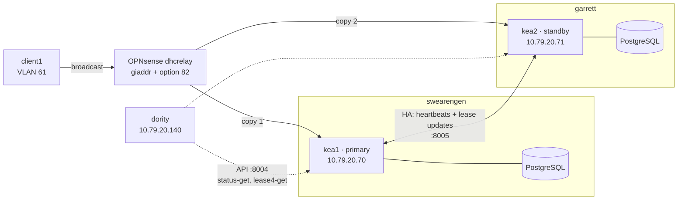

# Kea DHCPv4 High Availability — hot-standby pair

A second Kea server (`kea2`) added to the [Kea DHCP lab](KEA-DHCP-LAB.md), forming a
hot-standby pair with `kea1`: the primary answers every client, the standby holds a
live copy of every lease and takes over when the primary disappears. Failover was
tested end to end with a script that stops the primary, has a real client lease from
the standby, restarts the primary and checks that the lease came back.

| Result (2026-10-20, scripted run) | |
|---|---|
| Stop `kea1` → `kea2` in partner-down | **58.3 s** (manual run the night before: 58.7 s) |
| Client re-runs DHCP → lease from `kea2` (server id `10.79.20.71`) | **5.4 s** |
| `kea2` wrote a new lease while `kea1` was down | yes |
| Start `kea1` → both peers back in hot-standby | **21.6 s** |
| Gap during handback with no peer serving | **6.4 s** |
| Lease issued by `kea2` synced back to `kea1` | **PASS** (identical `cltt`) |

Times come from polling `status-get` once per second, so they're good to about 1 s.

Configs, deploy tooling and the failover test live in
[`homelab-automation/kea`](https://github.com/greenbeanorg/homelab-automation/tree/master/kea).
HA state is also exposed read-only through the `ha_status` tool added to the
[Kea MCP server](KEA-MCP-SERVER.md) in version 0.3.0 (§8).

---

## 1. Topology



| Item | Value |
|---|---|
| `kea1` | VM 950 on swearengen, `10.79.20.70`, role **primary** |
| `kea2` | VM 952 on garrett, `10.79.20.71`, role **standby** — a different physical host |
| Software | Kea 3.0.4 LTS (ISC `kea-3-0` RPMs), Rocky Linux 9, PostgreSQL 16 on each peer |
| Ports | 67/udp DHCP · 8004/tcp API (dority only) · 8005/tcp HA listener (other peer only) |
| Relay | OPNsense `dhcrelay` on `vlan07` (DHCPTEST), destinations `10.79.20.70 10.79.20.71` |
| Lease lifetimes | 3600 s, T1 900 s, T2 1800 s |

## 2. Design decisions

1. **Hot-standby, not load-balancing.** One server answers everything, so there is
   one place to look for any given lease and no split of the pool to reason about.
2. **Each peer keeps its own lease database.** No shared Postgres: a shared database
   would be the single point of failure HA is meant to remove. The HA hook replicates
   leases between the two databases.
3. **Dedicated HA listener on its own port.** Peer traffic (`ha-heartbeat`, lease
   updates, sync) goes to a listener the HA hook runs itself on :8005, separate from
   the API socket on :8004. ISC recommends this for multi-threaded servers, and since
   Kea 2.7 that listener refuses non-HA commands (`restrict-commands`, default true).
   No Kea Control Agent anywhere — it's deprecated in 3.0 and removed in 3.2.
4. **One config file for both peers.** The two files differ only in
   `this-server-name`. Both `peers` entries are listed in each file, and each server
   binds its HA listener to its own entry's URL. The API socket binds `0.0.0.0` so it
   doesn't need a per-host address; firewalld is what scopes it. `check-peer-diff.sh`
   enforces the "only one line differs" rule before every deploy.
5. **Secrets stay off the repo.** The HA peer password and API password are files under
   `/etc/kea` (`basic-auth-password-file`, `password-file`). The Postgres password
   must be inline in the config (the lease database block has no password-file
   option), so the repo copy holds `SET-AT-DEPLOY` and `deploy.sh` fills it in from an
   untracked file on dority.
6. **`max-unacked-clients: 0` — lab only.** See §6.3. Production uses a value above zero.

## 3. HA states, briefly

| State | What the server is doing | Serves clients? |
|---|---|---|
| `waiting` | Just started; asking the partner what state it's in | no |
| `syncing` | Pulling the partner's leases page by page | no |
| `ready` | Synced; waiting for the partner to acknowledge before resuming | no |
| `hot-standby` | Normal operation. The primary serves and sends every lease to the standby **before** replying to the client; the standby stores updates and drops client packets | primary only |
| `partner-down` | Partner presumed dead; this server serves the whole scope | yes |

`communication-interrupted` is a flag inside `status-get`, not a state: it's the warning
stage between the first missed heartbeat and `partner-down`.

Whether a server answers a given client is decided by its **scopes**: in hot-standby the
primary's scopes are `["kea1"]` and the standby's are `[]`. When the standby takes over,
its scopes become `["kea1"]`.

---

## 4. Building kea2 by cloning kea1

A clone is the fastest way to an identical package set, SELinux state and firewalld
layout. It also copies kea1's identity, which has to be undone before the clone ever
touches the network.

```bash
# swearengen (no storage is shared with garrett, so dump locally and copy)
vzdump 950 --mode snapshot --compress zstd --storage local
scp /var/lib/vz/dump/vzdump-qemu-950-<timestamp>.vma.zst root@10.79.10.25:/var/lib/vz/dump/

# garrett
qmrestore /var/lib/vz/dump/vzdump-qemu-950-<timestamp>.vma.zst 952 --storage local-lvm --unique 1
qm set 952 --name kea2
qm set 952 --net0 virtio=<new-mac>,bridge=vmbr0,firewall=1,tag=20,link_down=1
qm start 952
```

`--unique 1` gives the clone a new MAC. Without it both VMs present one MAC on VLAN 20
and the switch flaps it between ports. `link_down=1` keeps the clone off the network
until its identity is fixed. Snapshot mode used the guest agent's `fs-freeze`, so the
copy is filesystem-consistent; Postgres would recover from a crash-consistent copy too.

On the serial console (`qm terminal 952`):

```bash
sudo systemctl disable --now kea-dhcp4      # the clone must not run as an uncoordinated 2nd server
sudo rm /etc/machine-id && sudo systemd-machine-id-setup
sudo nmcli con mod servers0 ipv4.addresses 10.79.20.71/24 \
     802-3-ethernet.mac-address "" connection.interface-name eth0
printf '[main]\nno-auto-default=*\n' | sudo tee /etc/NetworkManager/conf.d/00-no-auto-default.conf
sudo nmcli con delete "Wired connection 1"
sudo -u postgres psql -d kea -c 'TRUNCATE lease4;'
sudo grep -rl 10.79.20.70 /etc             # anything else still pinned to kea1's address
```

Then `link_down` off, start, and add A + PTR records for `kea2.greenbean.org` on both Pi-holes.

Why each line:

- **kea-dhcp4 disabled first.** Until HA is configured the clone is a full copy of a
  working DHCP server for the same pools. On first boot it did try to start, and failed
  only because it couldn't bind kea1's 8004 address.
- **Empty `lease4`.** With an empty table, any lease that later appears on kea2 can
  only have come from HA replication. It turns "sync works" into something observable.
- **Hostname and SSH host keys** were handled by cloud-init, which treats a clone as a
  new instance. **Networking is not**: `99-disable-network-config.cfg` turns cloud-init
  networking off on this VM, so `qm set --ipconfig0` has no effect and the address
  lives in the NetworkManager profile `servers0`.

## 5. HA configuration

The HA hook entry (identical on both peers apart from `this-server-name`):

```json
{
  "library": "/usr/lib64/kea/hooks/libdhcp_ha.so",
  "parameters": {
    "high-availability": [ {
      "this-server-name": "kea1",
      "mode": "hot-standby",
      "heartbeat-delay": 10000,
      "max-response-delay": 60000,
      "max-ack-delay": 5000,
      "max-unacked-clients": 0,
      "sync-leases": true,
      "sync-timeout": 60000,
      "sync-page-limit": 10000,
      "restrict-commands": true,
      "multi-threading": {
        "enable-multi-threading": true,
        "http-dedicated-listener": true,
        "http-listener-threads": 0,
        "http-client-threads": 0
      },
      "peers": [
        { "name": "kea1", "url": "http://10.79.20.70:8005/", "role": "primary",
          "auto-failover": true, "basic-auth-user": "kea-ha",
          "basic-auth-password-file": "/etc/kea/kea-ha.pw" },
        { "name": "kea2", "url": "http://10.79.20.71:8005/", "role": "standby",
          "auto-failover": true, "basic-auth-user": "kea-ha",
          "basic-auth-password-file": "/etc/kea/kea-ha.pw" }
      ]
    } ]
  }
}
```

`libdhcp_lease_cmds.so` is loaded too — the HA hook uses its commands to send and sync leases.

**Peer password**, identical on both peers, never in Git:

```bash
openssl rand -base64 18 > ~/kea-ha.pw          # on dority, copied to each peer
sudo install -o root -g kea -m 0640 ~/kea-ha.pw /etc/kea/kea-ha.pw
```

**firewalld**: a source-based zone so only the other peer reaches :8005. Source zones are
matched before interface zones, so dority still lands in `kea-mgmt` (8004) and the relay
in `dhcp-relay` (67).

```bash
# kea1 (on kea2 the source is 10.79.20.70)
sudo firewall-cmd --permanent --new-zone=kea-peer
sudo firewall-cmd --permanent --zone=kea-peer --add-source=10.79.20.71/32
sudo firewall-cmd --permanent --zone=kea-peer --add-port=8005/tcp
sudo firewall-cmd --reload
```

**Deploy**: `deploy.sh kea1|kea2` runs the drift check, renders the Postgres password in,
installs the result as `kea-dhcp4.conf.candidate` with the live file's owner, mode and
SELinux label, and runs `kea-dhcp4 -t` on it. Activation is a separate, deliberate step:

```bash
sudo cp -a /etc/kea/kea-dhcp4.conf /etc/kea/kea-dhcp4.conf.prev
sudo mv /etc/kea/kea-dhcp4.conf.candidate /etc/kea/kea-dhcp4.conf
sudo systemctl restart kea-dhcp4
sudo ss -ltnp | grep -E ':(8004|8005)'   # 0.0.0.0:8004 and <own address>:8005
```

`kea-dhcp4 -t` on 3.0.4 opened and closed every hook library, so a missing `.so` is
caught, but no `HA_` messages appeared until the real start (`HA_CONFIGURATION_SUCCESSFUL`,
`HA_INIT_OK`) — treat HA parameters as validated only once the service has started.
`-t` also doesn't connect to Postgres, so a wrong database password passes it.

## 6. Bring-up order — start the primary first

The first bring-up started kea2 alone, as a harmless standby waiting for kea1. It
didn't stay harmless:

```
22:40:23  kea2: started ... as standby server          (WAITING, DHCP disabled)
22:41:23  kea2: WAITING -> PARTNER-DOWN, partner state is UNDEFINED
22:41:23  local DHCP service is enabled while kea2 is in the PARTNER-DOWN state
```

After `max-response-delay` with no answer from kea1, kea2 decided it was alone and
started serving. Nothing reached it — the relay didn't know about it yet — but when kea1
joined three minutes later the consequence showed:

```
22:44:51  kea1: WAITING -> SYNCING, partner state is PARTNER-DOWN
22:44:51  kea1: received 0 leases from kea2
22:44:53  kea2: PARTNER-DOWN -> HOT-STANDBY, partner state is READY
22:45:02  kea1: READY -> HOT-STANDBY
```

**The server coming out of partner-down is treated as authoritative** — it was the one
serving, so its database is assumed newest — and the returning server syncs *from* it.
kea1 pulled kea2's empty table (sync only adds, so kea1 kept its own lease), and kea2,
being the authority, never synced from kea1. Both peers reported hot-standby, but
kea2 held zero leases: a failover at that moment would have left it blind to every
dynamic lease. Restarting kea2 fixed it — it came back in `waiting`, found a healthy
primary and synced the right way (`received 1 leases from kea1`, 15 ms).

**Rule:** bring an empty or new standby up while the primary is reachable, then confirm
the lease count on the standby, not just the state.

### 6.1 Healthy pair

`status-get` on each peer reports its own state (`local`) and what it last heard from its
partner (`remote`):

| Field | kea1 | kea2 |
|---|---|---|
| `local.state` | `hot-standby` | `hot-standby` |
| `local.scopes` | `["kea1"]` | `[]` |
| `remote.last-state` | `hot-standby` | `hot-standby` |
| `remote.age` (s since last heartbeat) | 8 | 9 |
| `communication-interrupted` / `in-touch` | false / true | false / true |
| `clock-skew` | 0 | 0 |

### 6.2 Lease updates are live, not just a startup sync

kea2's copy of client1's lease moved from expiring 23:39 to 00:09 with no resync in
between: kea1 sent the renewal to kea2 before acknowledging the client. That's the
property that makes the standby useful — a client that got an address a moment before
the primary died is already known to the standby. The cost is that every exchange waits
for the partner, so HA throughput is below the single-node figure in the lab runbook.

### 6.3 Timers and why `max-unacked-clients` matters

| Parameter | Value | Role |
|---|---|---|
| `heartbeat-delay` | 10 s | How often each peer sends `ha-heartbeat` |
| `max-response-delay` | 60 s | Silence after which the partner is presumed down |
| `max-ack-delay` | 5 s | A client whose `secs` field exceeds this counts as unanswered |
| `max-unacked-clients` | 0 | Unanswered clients required before taking over; 0 = none |

With `max-unacked-clients: 0`, heartbeat silence alone triggers takeover. In this lab
that's necessary — one test client can never exceed a threshold — but it's what
produces split brain if only the link between the peers fails: each concludes its partner
is dead and both serve. With a value above zero, the standby also has to see real
clients retrying with growing `secs` and getting no answer, which only happens if the
primary has actually stopped serving. That's also why the relay must copy every packet
to both servers: the standby can only count unanswered clients it can see.

---

## 7. The relay and the renewal path

OPNsense **Services → DHCRelay**: the destination lists both servers.

```
/usr/local/sbin/dhcrelay -d -or -i vlan07 -C olt1-pon61 -R ont-client1 10.79.20.70 10.79.20.71
```

Every DISCOVER and REQUEST is sent to both, with the same `giaddr` and option 82. In
hot-standby kea2 receives and silently drops its copy. Without kea2 in that list it could
never serve anyone, even in partner-down.

Renewals don't use the relay: at T1 the client unicasts to the **server id** in its lease.
Leases from kea2 carry `10.79.20.71`, so the DHCPTEST rule for unicast renewals now
targets an alias:

| | |
|---|---|
| Alias `kea_servers` (Host) | `10.79.20.70`, `10.79.20.71` |
| DHCPTEST rule | pass UDP, *DHCPTEST net* → `kea_servers` port 67 |

```sh
pfctl -t kea_servers -T show
pfctl -sr | grep kea_servers
```

Kea's replies go to `giaddr` and arrive on OPNsense's SERVERS interface, already allowed
by the existing `SERVERS net → any` rule — nothing new needed.

## 8. Monitoring

`ha_status` (kea-mcp 0.3.0, see [KEA-MCP-SERVER.md](KEA-MCP-SERVER.md)) queries both peers with `status-get`
(already on the read-only allowlist — no new command was added) and returns each peer's
role, state, scopes and partner view, with `healthy: false` and a flag list when:

- a peer is unreachable or not in its normal state
- either peer reports `communication-interrupted`
- the last heartbeat is older than 30 s, or clock skew is 30 s or more (Kea stops HA at 60 s)
- the peers' views of each other disagree
- **both peers serve the same scope** (split brain), or **no peer serves any scope**

Peer URLs come from `KEA_HA_PEERS` in `.env`; tools take no URL argument, so a client of
the MCP server can't point it at another host.

---

## 9. Failover test

`homelab-automation/kea/failover-test.sh`, run from dority:

1. **Preflight**: both peers hot-standby, kea1 serving; ssh and sudo access to kea1 and
   client1 work; client1's lease is old enough that kea2 will have to write a new one (§10.1).
2. **Failover**: stop `kea-dhcp4` on kea1, poll kea2 once per second until `partner-down`.
3. **Client**: run `/usr/local/sbin/dhcp-cycle` on client1 — a root-owned helper that
   bounces the NetworkManager connection under `systemd-run`, so it survives the ssh
   session dropping with the address. Pass when client1's DHCP server id is `10.79.20.71`
   and kea2's `cltt` for the lease has changed.
4. **Failback**: start kea1, poll both until normal, timing any interval in which no
   peer lists a scope.
5. **Sync**: kea1's `cltt` for the lease must equal kea2's.

State comes from `status-get` and `lease4-get` over the API — the same read-only commands
the MCP server uses. The only privileged actions are covered by two narrow sudoers rules:

```
# kea1: /etc/sudoers.d/kea-failover-test
aba ALL=(root) NOPASSWD: /usr/bin/systemctl stop kea-dhcp4, /usr/bin/systemctl start kea-dhcp4
# client1: /etc/sudoers.d/kea-failover-test
aba ALL=(root) NOPASSWD: /usr/local/sbin/dhcp-cycle
```

If the script exits for any reason after stopping kea1, including Ctrl+C or a failed
check, it starts kea1 again. Each run is saved under `kea/results/`.

### 9.1 Results

```
09:41:31.269  kea1 stopped (t=0)
09:42:29.299  t= 58.3s  kea2: partner-down kea1
09:42:34.772  client1 leased 10.79.61.50 from server id 10.79.20.71 after 5.4s
09:42:34.775  kea2 wrote a new lease (cltt 1792489350)
09:42:35.065  kea1 started (t=0)
09:42:35.193  t=  0.4s  kea1: waiting  | kea2: partner-down kea1
09:42:45.792  t= 11.0s  kea1: ready    | kea2: partner-down kea1
09:42:50.045  t= 15.3s  kea1: ready    | kea2: hot-standby
09:42:56.418  t= 21.6s  kea1: hot-standby kea1 | kea2: hot-standby
09:42:56.452  kea1 cltt: 1792489350  kea2 cltt: 1792489350
```

**Failover — 58 s.** Working back from the transition, kea2's last successful
heartbeat was about 2 s before the stop. It moved to partner-down on the first heartbeat tick *after* `max-response-delay` had run
out, not at the instant it expired. Heartbeats drift to about 10.3 s apart (each is
scheduled after the previous attempt completes), so the worst case is roughly
`max-response-delay + heartbeat-delay`. For that whole minute **no server answered new
DHCP requests**; clients holding leases didn't notice. A shorter `max-response-delay`
shrinks the gap at the price of faster takeovers when the peer link is merely slow.

**Failback — 22 s, with a 6 s gap.** kea1 spends one heartbeat interval in `waiting`
and syncs, then sits in `ready`. kea2 leaves partner-down as soon as it sees kea1 READY
and stops serving; kea1 only starts serving on its next heartbeat. Between 15.3 s and
21.6 s neither peer had a scope. The manual run the night before showed the same gap,
seen there with 5 s polling.

**Sync back.** kea1 came up in `waiting`, found kea2 in partner-down — the authority, per
§6 — and synced from it, picking up the lease kea2 wrote while kea1 was down.

---

## 10. Gotchas

### 10.1 Lease caching hid the write

The first scripted run failed its "kea2 wrote a new lease" check even though client1 got
its address from kea2. kea2's log explained it:

```
09:34:15.991  DHCP4_LEASE_ALLOC ... lease 10.79.61.50 has been allocated for 3600 seconds
09:34:15.991  DHCP4_LEASE_REUSE ... lease 10.79.61.50 has been reused for 3045 seconds
```

Kea 3.0 enables lease caching by default (`cache-threshold` 0.25): a client returning
before 25% of its lifetime has passed gets the existing lease back with no database
write. The lease was 555 s old (3600 − 3045), under the 900 s threshold.

- **`DHCP4_LEASE_ALLOC` is logged even on reuse.** Only the `DHCP4_LEASE_REUSE` line
  beside it says nothing was written. Grepping for ALLOC alone overstates writes.
- **It explains a 30-minute write cadence.** With T1 at 900 s — exactly the threshold —
  every other renewal is a reuse, so the stored lease changes every 30 minutes, not 15.
  kea2's copy moving 23:39 → 00:09 in §6.2 is that pattern.
- **Nothing to replicate on a reuse**, so HA sees no update either. The test script now
  waits until the lease is past the threshold (plus margin) before stopping kea1, so the
  standby has to write and the sync check means something.

### 10.2 Clone networking

- The NetworkManager profile `servers0` had `interface-name=eth0` **and**
  `mac-address=` kea1's MAC. NetworkManager requires both to match, so on the clone it
  silently skipped `servers0` and activated the in-memory fallback
  `Wired connection 1`, which took `10.79.20.201` from OPNsense by DHCP. The gateway was
  reachable, nothing answered on `.71`, and the server was "up" at a surprise address.
- Fix: bind server profiles by interface name only, and set `no-auto-default=*` so a
  failed profile leaves the NIC with no address instead of a DHCP one. Applied to both peers.

### 10.3 The HA listener doesn't check credentials

A kea-users report from January 2026 (Kea 3.0.2) said the dedicated HA listener accepted
any credentials. Tested on 3.0.4 from kea1 against kea2's listener, sending the read-only
`ha-heartbeat`:

```
-u kea-ha:WRONG      200
no credentials       200
```

Both were accepted. As far as the configuration goes, `basic-auth-user` and
`basic-auth-password-file` on a peer entry set what a server *presents* when it calls
that peer; nothing here makes the listener demand them. `restrict-commands` limits the
listener to HA commands, but those are the commands the peers use on each other — lease
updates and sync among them — so the listener can't be treated as harmless.

**The control is the network.** The `kea-peer` firewalld zone admits only the other
peer's address to 8005, on both servers; a request to 8005 from dority, which can reach
the API on 8004, gets no answer. The peer password stays configured — it costs nothing
and starts mattering if a release enforces it — but it isn't relied on.

Retest after every Kea upgrade:

```bash
ssh aba@10.79.20.70 'curl -s -o /dev/null -w "%{http_code}\n" -u kea-ha:WRONG \
  -H "Content-Type: application/json" -d "{\"command\":\"ha-heartbeat\"}" http://10.79.20.71:8005/'
# 401 = credentials now enforced; 200 = still open, firewall is the only control
```

### 10.4 Smaller notes

- **The clone's first boot** logged `bind: Cannot assign requested address` for
  `10.79.20.70:8004` and exited. Harmless — that failure is what kept the clone from
  serving as a second, independent DHCP server before it was disabled.
- **journald** reported a corrupted journal on the clone's first boot (the snapshot
  caught it mid-write); it was renamed and replaced automatically.
- **The `0.0.0.0` API bind changes nothing on the wire** — firewalld still admits only
  dority to 8004, which the first API call to kea2 confirmed.

---

## 11. Not tested, and production differences

- **Clients finding their way back to the primary.** After failback, client1 holds a
  lease with server id `.71`; its T1 renewal unicasts to kea2, which as standby drops it,
  and the client should rebind by broadcast at T2 and get kea1. Expected, not observed.
- **Split brain** was reasoned about (§6.3) and `ha_status` flags it in simulated tests, but
  the peer link was never cut while both servers stayed up.
- **`max-unacked-clients` above zero** — production setting, untestable with one client.
- **Peer traffic is plain HTTP, and unauthenticated in practice (§10.3).** Production
  would use TLS between peers; the HA hook takes `trust-anchor`, `cert-file` and
  `key-file` per peer. Whether mutual TLS on the dedicated listener closes the gap in
  §10.3 hasn't been tested here.
- **The single-server MCP tools** (`kea_health`, `lease_lookup`, `pool_utilization`)
  still query only kea1, so during a failover they report kea1 unreachable while
  `ha_status` shows kea2 serving. Following the serving peer is a natural next step.
- **Load** — the HA pair hasn't been load-tested; the single-node numbers in the lab
  runbook don't carry over, because each exchange now waits for the partner.

---

## Quick reference

| | |
|---|---|
| Peers | `kea1` VM 950 swearengen `10.79.20.70` primary · `kea2` VM 952 garrett `10.79.20.71` standby |
| Configs | `homelab-automation/kea/kea{1,2}/kea-dhcp4.conf` · `check-peer-diff.sh` · `deploy.sh kea1\|kea2` |
| HA state | `curl -u mcp-ro:<pw> -H 'Content-Type: application/json' -d '{"command":"status-get"}' http://10.79.20.7{0,1}:8004/ \| jq '.[0].arguments["high-availability"]'` |
| HA log lines | `sudo grep -E 'HA_STATE_TRANSITION\|HA_SYNC\|HA_LEASES_SYNC' /var/log/kea/kea-dhcp4.log` |
| Leases on a peer | `sudo -u postgres psql -d kea -Atc 'select address, hostname, expire from lease4'` (address is an integer: 172965170 = 10.79.61.50) |
| Failover test | `cd ~/git/homelab-automation/kea && ./failover-test.sh` (`NO_WAIT=1` skips the cache wait) |
| Relay | `pgrep -lf dhcrelay` · `pfctl -t kea_servers -T show` (OPNsense) |
| Listeners | `sudo ss -ltnp \| grep -E ':(8004\|8005)'` |
| Peer firewall | `sudo firewall-cmd --zone=kea-peer --list-all` |
| Resync a standby | restart `kea-dhcp4` on it while the primary is healthy |
