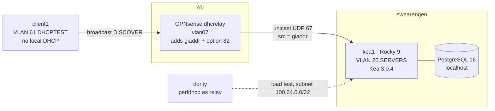

# Kea DHCP Lab — Relayed DHCPv4 on Rocky Linux 9

**Status:** COMPLETE — core lab (Steps 1–6) built and verified 2026-10-17; stretch goals open, see [§12](#12-still-ahead)
**Built:** 2026-10-16 → 2026-10-17
**Hosts:** `kea1` (VM 950, Rocky Linux 9.8, swearengen), `client1` (VM 951, Rocky Linux 9.8, swearengen), OPNsense on `wu` as relay agent, `dority` as load generator
**Stack:** ISC Kea 3.0.4 (LTS), PostgreSQL 16 (AppStream), OpenBSD `dhcrelay` on OPNsense, firewalld, SELinux enforcing
**Purpose:** Interview prep for an ISP Core Platforms role where ISP-scale DHCP was the identified gap. Lab only — the test VLAN carries no real clients.

An ISP-style DHCPv4 build: a central Kea server that never serves its own link,
reached only through a relay that stamps every request with `giaddr` and option 82.
On top of that: a circuit-id host reservation, a PostgreSQL lease backend, Kea's
HTTP API with `lease_cmds` / `stat_cmds`, and a `perfdhcp` load test that found
the server's saturation point and proved what limits it.

---

## 1. The plain-language version, first

- **On a home network the DHCP server sits on the same wire as the clients.**
  A new device shouts "I need an address" (a broadcast) and the server on that
  wire answers.
- **At an ISP that can't work.** Thousands of subscriber segments hang off OLTs
  and routers; the DHCP servers live in a datacenter. Broadcasts don't cross
  routers.
- **So the router on each segment acts as a mailroom — the *relay agent*.** It
  catches the shout, puts it in an envelope and writes two things on the outside:
  - **the return address** — which segment it came from (`giaddr`, the relay's
    own IP on that segment)
  - **a delivery note** — which port/circuit the subscriber is plugged into
    (option 82: `circuit-id` / `remote-id`)
- **The central server reads the envelope, not the shout.** `giaddr` picks the
  subnet's pool. Option 82 identifies *who* this is — by the port they're on,
  not a MAC address they can change.
- **The server's own wire is irrelevant.** It never answers anything it hears
  directly, only relayed envelopes. This lab enforces that on purpose.

---

## 2. Topology



**Physical path for VLAN 61** (every hop had to know the VLAN — see [§9](#9-gotchas)):

```
client1 → tap951i0 → swearengen vmbr0 → enp4s0f0 → TL-SG108E (ports 1–2 tagged)
        → CRS310 (ether8 → ether7) → wu enp2s0 → vmbr0 → OPNsense vtnet0 → vlan07
```

| Item | Value |
|---|---|
| Test VLAN | 61 `DHCPTEST`, `10.x.x.0/24`; relay/gateway `10.x.x.1` on OPNsense (`opt7` / device `vlan07`) |
| `kea1` | VM 950, SERVERS (VLAN 20), static `10.x.x.70/24`, user `aba` |
| `client1` | VM 951, VLAN 61, DHCP — dynamic `10.x.x.100`, then reserved `10.x.x.50` |
| Lab IP block | SERVERS `.70–.79` (`kea1` = .70, `.71` held for `kea2`). `.40`, `.50`, `.60–.62` belong to the k3s lab |
| Dynamic pool (VLAN 61) | `.100 – .199` |
| Circuit reservation | `.50` (outside the pool) |
| Load-test subnet | `100.64.0.0/22` (CGNAT space), selected by relay address `dority` = `10.x.x.140` |
| Resolvers handed out | `10.x.x.250`, `10.x.x.249` (Pi-holes) |

---

## 3. Design decisions

1. **Relay-only server.** `kea1` has no subnet for its own VLAN and uses
   `dhcp-socket-type: udp`, so it only processes unicast, relayed traffic. A
   request without a relay matches no subnet and is dropped. Subnet selection
   is explicit: `giaddr` picks the subnet, not the wire the packet arrived on.
   OPNsense's own Kea is **not** bound to the test interface.
2. **An empty VLAN for the test segment.** VLAN 61 carries only `client1`, so a
   lease on VLAN 61 can only have come through the relay.
3. **Rocky Linux 9, not Debian.** The target environment is RHEL-family and
   VMware-hosted: dnf, firewalld (ports opened properly, never disabled),
   SELinux enforcing, NetworkManager keyfiles.
4. **ISC `kea-3-0` LTS packages, not EPEL.** EPEL ships Kea 2.6.5 (EOL upstream).
   ISC's Cloudsmith repos are upstream; `kea-3-2` is current stable, `kea-3-0`
   is LTS. EPEL is excluded from supplying `kea*` so the two can never mix.
5. **API on the DHCP daemon, not the Control Agent.** `kea-ctrl-agent` was
   deprecated in Kea 3.0 and **removed in 3.2**. `kea-dhcp4` serves its own
   authenticated HTTP control socket, so tooling built on it survives an upgrade.
6. **Source-based firewalld zone for DHCP.** Only the relay, the subscriber
   prefix (for unicast renewals) and the load generator can reach UDP 67. Adding
   a relay means adding a source.
7. **Circuit-id first.** `host-reservation-identifiers` checks circuit-id before
   MAC — the address follows the port, not the CPE.
8. **`store-extended-info: true`.** Every lease records the relay info that
   produced it, so "which circuit holds this IP?" is one API call.
9. **PostgreSQL on `kea1`, natively from AppStream.** Not the existing k3s-lab
   Postgres (it backs a portfolio app), and not Docker (RHEL ships Podman, and
   native install is more RHEL practice). Disposable with the VM.
10. **Keep serving if the database drops.** `on-fail: serve-retry-continue`.

---

## 4. Step 1 — The test segment and the two VMs

### 4.1 VLAN 61 on the switches

CRS310 — same pattern as every other VLAN:

```routeros
/interface bridge vlan add bridge=bridge vlan-ids=61 tagged=ether2,ether7,ether8 comment=DHCPTEST
/interface bridge vlan print detail where vlan-ids=61
```

TL-SG108E (sunroom) — **VLAN → 802.1Q VLAN**, ID `61`, name `DHCPTEST`, ports
1–2 tagged (mirrors VLAN 60), everything else not-member, **Add/Modify**. This
step was initially missed — see [§8.1](#81-vlan-61-dropped-by-the-tl-sg108e).

### 4.2 OPNsense interface

1. Interfaces → Devices → VLAN: parent `vtnet0`, tag `61`, device `vlan07`
   (`vlan01`–`vlan06` were taken), description `DHCPTEST`.
2. Interfaces → Assignments: add as `DHCPTEST` (`opt7`).
3. Enable, Static IPv4 `10.x.x.1/24`, no upstream gateway.
4. **Not** selected under Kea DHCP → Settings → Interfaces; no subnet defined.

```sh
ifconfig vlan07 | head -3
sockstat -4l | grep ':67'          # six existing Kea listeners; DHCPTEST must not appear
```

### 4.3 kea1

Rocky 9 GenericCloud image + Proxmox cloud-init. `--cpu host` is mandatory (EL9
needs x86-64-v2).

```bash
wget https://dl.rockylinux.org/pub/rocky/9/images/x86_64/Rocky-9-GenericCloud-Base.latest.x86_64.qcow2
qm create 950 --name kea1 --memory 2048 --cores 2 --cpu host --ostype l26 --agent 1 \
  --scsihw virtio-scsi-single --net0 virtio,bridge=vmbr0,tag=20,firewall=1
qm set 950 --scsi0 local-lvm:0,import-from=/root/Rocky-9-GenericCloud-Base.latest.x86_64.qcow2
qm disk resize 950 scsi0 20G
qm set 950 --ide2 local-lvm:cloudinit --boot order=scsi0 --serial0 socket --vga serial0
qm set 950 --ciuser aba --sshkeys /root/<pubkey-file> --cipassword '<console-password>' \
  --ipconfig0 ip=10.x.x.70/24,gw=10.x.x.1 \
  --nameserver "10.x.x.250 10.x.x.249" --searchdomain greenbean.org
qm start 950
```

Baseline on the guest:

```bash
sudo hostnamectl set-hostname kea1.greenbean.org

# Stop cloud-init owning the network; convert its legacy ifcfg file to a keyfile
echo 'network: {config: disabled}' | sudo tee /etc/cloud/cloud.cfg.d/99-disable-network-config.cfg
sudo nmcli connection migrate "System eth0"
sudo nmcli con mod "System eth0" connection.id servers0
sudo nmcli con mod servers0 ipv4.method manual ipv4.addresses 10.x.x.70/24 \
  ipv4.gateway 10.x.x.1 ipv4.dns "10.x.x.250 10.x.x.249" ipv4.dns-search greenbean.org
sudo mv "/etc/NetworkManager/system-connections/System eth0.nmconnection" \
        /etc/NetworkManager/system-connections/servers0.nmconnection
sudo nmcli connection reload

# firewalld (not in the GenericCloud image), trimmed to ssh only
sudo dnf -y install firewalld && sudo systemctl enable --now firewalld
sudo firewall-cmd --permanent --remove-service=cockpit --remove-service=dhcpv6-client
sudo firewall-cmd --reload

# Repos and tooling
sudo dnf -y install epel-release dnf-plugins-core
sudo dnf config-manager --set-enabled crb
sudo dnf config-manager --set-disabled epel-cisco-openh264
sudo dnf -y install policycoreutils-python-utils setroubleshoot-server tcpdump jq vim-common nmap-ncat
```

Reboot test passed: hostname, manual `/24`, keyfile, firewalld `ssh`-only, SELinux `Enforcing`.

ISC repository (script read before running as root), with EPEL pinned away from Kea:

```bash
curl -1sLf -o /tmp/kea-setup.sh 'https://dl.cloudsmith.io/public/isc/kea-3-0/setup.rpm.sh'
less /tmp/kea-setup.sh && sudo bash /tmp/kea-setup.sh
sudo dnf config-manager --save --setopt=epel.excludepkgs='kea*'
sudo dnf config-manager --set-disabled isc-kea-3-0-source
dnf list 'isc-kea*'          # 3.0.4 .el9
```

### 4.4 client1

```bash
qm create 951 --name client1 --memory 1024 --cores 1 --cpu host --ostype l26 \
  --scsihw virtio-scsi-single --net0 virtio,bridge=vmbr0,tag=61
qm set 951 --scsi0 local-lvm:0,import-from=/root/Rocky-9-GenericCloud-Base.latest.x86_64.qcow2
qm set 951 --ide2 local-lvm:cloudinit --boot order=scsi0 --serial0 socket --vga serial0
qm set 951 --ciuser aba --cipassword '<console-password>' --sshkeys /root/<pubkey-file> --ipconfig0 ip=dhcp
qm start 951 && qm terminal 951
```

First boot stalls waiting for DHCP and `cloud-final` fails (a final-stage module
needs network). Both expected; login works.

### 4.5 Checkpoint 1 ✅ — segment up, isolated

Traced hop by hop with `tcpdump` until the DISCOVER arrived unanswered on OPNsense:

```bash
tcpdump -ni tap951i0 -e port 67 or port 68          # swearengen: leaves client1
tcpdump -ni enp4s0f0 -e vlan 61                     # swearengen uplink: tagged 61
tcpdump -ni enp2s0 -e vlan 61                       # wu uplink: arrives
```
```sh
tcpdump -ni vlan07 port 67 or port 68               # OPNsense: arrives, nobody answers
```

---

## 5. Step 2 — Kea, relay-only

```bash
sudo dnf -y install isc-kea-dhcp4 isc-kea-hooks
sudo kea-dhcp4 -V | head -1                         # 3.0.4 — sudo required, see gotchas
sudo cp -a /etc/kea/kea-dhcp4.conf /etc/kea/kea-dhcp4.conf.dist
```

Initial config (relay-only, memfile). Key choices:

```json
"interfaces-config": {
  "interfaces": [ "eth0" ],
  "dhcp-socket-type": "udp",
  "service-sockets-require-all": true
},
"subnet4": [ {
  "id": 61,
  "subnet": "10.x.x.0/24",
  "pools": [ { "pool": "10.x.x.100 - 10.x.x.199" } ],
  "option-data": [ { "name": "routers", "data": "10.x.x.1" } ]
} ]
```

- No subnet for the server's own `10.x.x.0/24` — that's the relay-only rule.
- `service-sockets-require-all` — fail loudly at start rather than run deaf.
- Unix control socket named bare (`kea4-ctrl-socket`) — Kea 3.0 restricts socket
  paths to its own run directory (`/var/run/kea/`).

```bash
sudo kea-dhcp4 -t /etc/kea/kea-dhcp4.conf && echo CONFIG OK
sudo systemctl enable --now kea-dhcp4
sudo ss -ulnp | grep ':67'                          # 10.x.x.70:67 only
```

**SELinux finding:** the ISC binary is labelled `bin_t` and runs as
`unconfined_service_t` — no policy confines third-party Kea on EL9. PostgreSQL
from AppStream, by contrast, runs confined as `postgresql_t`. No AVC denials at
any point. Confining Kea is an open item ([§12](#12-still-ahead)).

### Checkpoint 2 ✅ — config valid, service active, bound to one address, no AVCs

---

## 6. Step 3 — Relay with option 82

### 6.1 OPNsense relay

Services → DHCRelay. **Create the destination first** — the relay's Destination
field only lists existing destinations.

| | |
|---|---|
| Destination | `kea1` → `10.x.x.70` |
| Relay | Interface `DHCPTEST`, destination `kea1`, Agent Information ✔ |
| Circuit id | `olt1-pon61` |
| Remote id | `ont-client1` |

Running process (OpenBSD `dhcrelay`, not ISC's):

```
/usr/local/sbin/dhcrelay -d -or -i vlan07 -C olt1-pon61 -R ont-client1 10.x.x.70
```

### 6.2 Three flows, three firewall decisions

1. **DISCOVER broadcast** — `dhcrelay` reads it off the interface; no pf rule needed.
2. **Server reply** — Kea answers **to `giaddr`**, not to the sender. It leaves
   via `kea1`'s default gateway and arrives on OPNsense's SERVERS interface. The
   existing `SERVERS net → any` rule already allows it.
3. **Unicast renewal at T1** — the client renews straight to the server ID,
   bypassing the relay. New DHCPTEST rule: pass UDP, *DHCPTEST net* →
   `10.x.x.70/32` port 67, "DHCPTEST unicast renewals to kea1".

### 6.3 kea1 firewalld zone

```bash
sudo firewall-cmd --permanent --new-zone=dhcp-relay
sudo firewall-cmd --permanent --zone=dhcp-relay --add-source=10.x.x.1/32       # the relay (see §8.3)
sudo firewall-cmd --permanent --zone=dhcp-relay --add-source=10.x.x.0/24       # subscriber prefix, renewals
sudo firewall-cmd --permanent --zone=dhcp-relay --add-service=dhcp
sudo firewall-cmd --reload
sudo firewall-cmd --get-active-zones       # dhcp-relay (sources) + public (eth0)
```

Source zones are matched before interface zones, so only these sources reach UDP 67.

### 6.4 Checkpoint 3 ✅ — first relayed lease

`client1` received `10.x.x.100/24`, gateway `10.x.x.1`, both Pi-holes.
`tcpdump -ni eth0 -vv port 67` on `kea1` showed the full DORA:

| Field in capture | Meaning |
|---|---|
| `10.x.x.1.bootps > 10.x.x.70.bootps` | Relay sources from `giaddr`, unicast to the server |
| `Gateway-IP 10.x.x.1`, `hops 1` | `giaddr` set; Kea selected subnet 61 from it |
| `Circuit-ID … olt1-pon61`, `Remote-ID … ont-client1` | Option 82 as configured |
| Reply to `10.x.x.1.bootps` | Kea answers `giaddr` |
| Option 82 echoed in OFFER/ACK | Required by RFC 3046; relay strips it before forwarding |
| `Server-ID 10.x.x.70` | Why renewals go direct to `kea1` |
| `bad udp cksum` on outbound | Checksum offload — captured before the virtio NIC fills it in. Harmless |

---

## 7. Steps 4–6

### 7.1 Step 4 — Reservation by circuit-id ✅

```json
"host-reservation-identifiers": [ "circuit-id", "hw-address", "client-id" ],
"store-extended-info": true,
...
"reservations": [ {
  "circuit-id": "'olt1-pon61'",
  "ip-address": "10.x.x.50",
  "hostname": "olt1-pon61-static"
} ]
```

- Single quotes inside the JSON string = text circuit-id; without them Kea expects
  hex (`6f:6c:74:…`), which is what binary circuit-ids from real OLTs need.
- Reserved address deliberately **outside** the dynamic pool.
- Applied with `sudo systemctl kill -s HUP kea-dhcp4` — in-place reload, no restart
  (`DHCP4_DYNAMIC_RECONFIGURATION_SUCCESS`).

On `nmcli con down/up` the capture showed the reservation overriding the existing lease:

```
Request  Requested-IP 10.x.x.100
NACK                                   ← reservation now says .50
Discover Requested-IP 10.x.x.100
Offer    Your-IP 10.x.x.50
```

The memfile CSV is append-only: one row per lease change (old `.100` reappears
with `valid_lifetime 0` = released). LFC compacts it hourly. Extended info lands
in `user_context` as hex — suboption `01` len `0A` `olt1-pon61`, suboption `02`
len `0B` `ont-client1` (type-length-value):

```bash
python3 -c "print(bytes.fromhex('010A6F6C74312D706F6E3631020B6F6E742D636C69656E7431'))"
```

### 7.2 Step 5a — HTTP API, `lease_cmds`, `stat_cmds` ✅

```bash
sudo sh -c 'umask 077; openssl rand -base64 24 | tr -d "\n" > /etc/kea/kea-api-mcp.pw'
sudo chown kea:kea /etc/kea/kea-api-mcp.pw
```

```json
"control-sockets": [
  { "socket-type": "unix", "socket-name": "kea4-ctrl-socket" },
  { "socket-type": "http", "socket-address": "127.0.0.1", "socket-port": 8004,
    "authentication": { "type": "basic", "realm": "kea-dhcp4", "directory": "/etc/kea",
      "clients": [ { "user": "mcp-ro", "password-file": "kea-api-mcp.pw" } ] } }
]
```

Bound to loopback until a consumer exists. Queried with curl:

```bash
PW=$(sudo cat /etc/kea/kea-api-mcp.pw)
kea() { curl -s -u "mcp-ro:$PW" -H 'Content-Type: application/json' -d "$1" http://127.0.0.1:8004/ | jq; }
kea '{"command":"status-get"}'
kea '{"command":"lease4-get","arguments":{"ip-address":"10.x.x.50"}}'
kea '{"command":"lease4-get-by-hw-address","arguments":{"hw-address":"<client1-mac>"}}'
kea '{"command":"stat-lease4-get","arguments":{"subnet-id":61}}'
kea '{"command":"statistic-get-all"}'
```

| Command | Feeds MCP tool |
|---|---|
| `lease4-get`, `lease4-get-by-hw-address` (with relay info in `user-context`) | `lease_lookup()` |
| `stat-lease4-get` (total / assigned / declined per subnet) | `pool_utilization()` |
| `status-get` (sockets, MT state, uptime), `version-get` | `kea_health()` |

Response facts that matter for client code: replies are a **JSON array** even on
the direct socket (take `[0]`); `result` 0 = ok, 1 = error, 2 = unsupported,
3 = empty / not found.

### 7.3 Step 5b — PostgreSQL lease backend ✅

```bash
sudo dnf -y module enable postgresql:16
sudo dnf -y install postgresql-server
sudo postgresql-setup --initdb && sudo systemctl enable --now postgresql

sudo sh -c 'umask 077; openssl rand -base64 24 | tr -d "\n/+=" > /etc/kea/kea-db.pw'
sudo chown kea:kea /etc/kea/kea-db.pw
DBPW=$(sudo cat /etc/kea/kea-db.pw)
sudo -u postgres psql -c "CREATE ROLE kea LOGIN PASSWORD '$DBPW';"
sudo -u postgres psql -c "CREATE DATABASE kea OWNER kea;"
```

`/var/lib/pgsql/data/pg_hba.conf`, **above** RHEL's default `ident` lines (first match wins):

```
host    kea       kea   127.0.0.1/32   scram-sha-256
```

```bash
sudo systemctl reload postgresql
sudo dnf -y install isc-kea-pgsql isc-kea-admin
sudo kea-admin db-init pgsql -h 127.0.0.1 -u kea -p "$DBPW" -n kea
```

Config changes — **the backend is a hook in Kea 3.0** and must be loaded first:

```json
"lease-database": {
  "type": "postgresql", "name": "kea", "host": "127.0.0.1", "port": 5432,
  "user": "kea", "password": "<db-password>",
  "max-reconnect-tries": 5, "reconnect-wait-time": 3000,
  "on-fail": "serve-retry-continue"
},
"hooks-libraries": [
  { "library": "/usr/lib64/kea/hooks/libdhcp_pgsql.so" },
  { "library": "/usr/lib64/kea/hooks/libdhcp_lease_cmds.so" },
  { "library": "/usr/lib64/kea/hooks/libdhcp_stat_cmds.so" }
]
```

Applied with `jq` against a known-good copy, validated as a candidate, then swapped
in (see [§8.2](#82-postgresql-backend-outage) for why). Verified:

```
DHCPSRV_LEASE_MGR_BACKENDS_REGISTERED ... memfile postgresql
PGSQL_LB_DB opening PostgreSQL lease database: host=127.0.0.1 ... password=***** ...
```

```bash
PGPASSWORD="$DBPW" psql -h 127.0.0.1 -U kea -d kea -c \
"select inet '0.0.0.0' + address as ip, encode(hwaddr,'hex') as mac, subnet_id, hostname, expire, user_context from lease4;"
```

Lease `10.x.x.50`, hostname `olt1-pon61-static`, relay info in `user_context`. The
API returned the same lease unchanged — tooling talks to Kea, not the tables.

### 7.4 Step 6 — Load test with `perfdhcp` ✅

**Method.** `perfdhcp` on `dority` (same VLAN as `kea1`) pointed at `kea1`'s
unicast address acts as a relay: `giaddr` = its own IP. A throwaway subnet keeps
synthetic clients out of real pools:

```json
{ "id": 100, "subnet": "100.64.0.0/22",
  "pools": [ { "pool": "100.64.0.10 - 100.64.3.250" } ],
  "relay": { "ip-addresses": [ "10.x.x.140" ] },
  "valid-lifetime": 300, "renew-timer": 100, "rebind-timer": 200 }
```

`giaddr` `10.x.x.140` falls in no subnet prefix, so Kea falls back to the subnet's
`relay` list. Pool = 1009 addresses; `-R 900` keeps client count below it so pool
exhaustion can't masquerade as overload. `dority` added to the `dhcp-relay` zone.
perfdhcp from ISC's `kea-3-0` deb repo (`isc-kea-perfdhcp`, lives in `/usr/sbin`).

```bash
sudo perfdhcp -4 -l 10.x.x.140 -r <rate> -R 900 -p 30 10.x.x.70
```

**Results** — 2 vCPU / 2 GB VM, Kea 3.0.4 multi-threaded (defaults: 2 threads,
queue 64), local PostgreSQL, INFO lease logging on:

| Requested | Achieved | Drops | Avg delay D-O / R-A | Max delay |
|---|---|---|---|---|
| 10/s | 9.9 | 0 | 3.2 / 4.9 ms | 38 ms |
| 100/s | 99.97 | 0 | 1.2 / 1.9 ms | 13 ms |
| 300/s | 299.96 | 0 | 0.55 / 0.55 ms | 3.4 ms |
| 600/s | 599.95 | 0 | 1.0 / 1.2 ms | 37 ms |
| 1000/s | 999.89 | 0.003% (1) | 0.46 / 0.53 ms | 7.6 ms |
| 2000/s | 1934 | 1.7% | 1.4 / 1.2 ms | 34 ms |
| 4000/s | **2706** | **17.7%** | **9.1 / 9.1 ms** (σ 1 ms) | 22 ms |

**Capacity:** clean to ~1,000 exchanges/s, degrading ~2,000/s, saturated ~2,700/s.
Latency *fell* as rate rose (CPU power states and idle connections at low rate);
the occasional 35–38 ms spikes are the number a capacity plan has to absorb.

**Where were packets lost?** Counted at every layer:

| Layer | Evidence | Lost here? |
|---|---|---|
| Generator TX (`dority` `ens18`) | TX dropped 0 | No |
| Proxmox tap (`tap950i0` on swearengen) | RX/TX dropped 0 | No |
| `kea1` NIC | RX dropped 0 | No |
| `kea1` kernel UDP buffer | `UdpRcvbufErrors` 0 | No |
| Generator RX (`dority`) | `UdpRcvbufErrors` 8 | Negligible |
| Kea processing | `offer-sent` = `discover-received` exactly | No — every counted packet answered |
| **Kea MT packet queue** | perfdhcp sent 240,092 DISCOVERs, Kea counted 217,774 — the ~22.3k gap matches perfdhcp's 22,363 drops | **Yes** — discarded before stats are counted |

**Hypothesis test.** Raised `thread-pool-size` 2→4 and `packet-queue-size` 64→256,
reran 4000/s:

| | Queue 64, 2 threads | Queue 256, 4 threads |
|---|---|---|
| Achieved | 2706/s | 2701/s |
| Drops | 17.7% | 18.1% |
| Avg latency | 9 ms | **35 ms** |

A 4× deeper queue gave ~4× the latency and no extra throughput: **CPU-bound.**
Fixes are cores or scale-out (HA load-balancing pair), not buffers. A deep queue
during a reconnect storm means answering packets clients already gave up on.
Reverted to defaults.

**Caveat:** `-R 900` reuses the same MACs, so after the first run this measured
mostly *returning* clients (lookup + extend), not fresh allocations — realistic for
ONTs coming back after an outage, optimistic for brand-new allocations.

Cleanup: `delete from lease4 where subnet_id=100;` (900 rows). See gotcha 15.

---

## 8. Incidents and corrections

### 8.1 VLAN 61 dropped by the TL-SG108E

**Symptom:** DISCOVERs left swearengen tagged 61 (`tcpdump -e vlan 61` on
`enp4s0f0`) but never reached `wu`'s uplink.
**Ruled out:** both Proxmox bridges (VLAN-aware, no explicit `bridge-vids`, so
2–4094), OPNsense vNIC (`trunks=2-4094`), CRS310 (configured).
**Cause:** swearengen hangs off the sunroom TL-SG108E, whose 802.1Q table stopped
at VLAN 60. Unknown VLANs are dropped silently.
**Fix:** VLAN 61 tagged on ports 1–2 (Add/Modify — not Apply, which only toggles 802.1Q).
**Lesson:** a new VLAN goes on *every* 802.1Q device in the path. Found by capturing
hop by hop until the packet disappeared.

### 8.2 PostgreSQL backend outage

**Symptom:** after switching `lease-database` to `postgresql`, `client1` couldn't
get an address. `kea-dhcp4 -t` had passed.
**Cause:** in Kea 3.0 the PostgreSQL backend is a hook (`libdhcp_pgsql.so`). Without
it: `DHCPSRV_UNKNOWN_DB unknown database type: postgresql` → `DHCP4_INIT_FAIL`.
`-t` validates syntax/structure but doesn't load the lease backend, so it can't catch this.
**Compounding:** a hand edit in `vi` then pasted the hooks block outside `Dhcp4`
(`syntax error, unexpected constant string, expecting Dhcp4` at line 2).
**Recovery:** restored service first from the known-good backup
(`kea-dhcp4.conf.step5a`), then made the change with `jq`, validated the candidate
file, swapped it in, restarted, and checked `is-active` plus the log.
**Lessons:** a passing `-t` doesn't prove the service starts. Restore before you
debug. Structured edits beat hand edits for JSON configs. `on-fail` only covers a
database lost *after* startup, not a backend that can't load.

### 8.3 Relay source address — prediction wrong

Predicted the relay would source from its SERVERS address. The capture showed
OpenBSD `dhcrelay` sources from the **`giaddr` interface address**. It worked only
because the subscriber `/24` in the firewalld zone covered it; the zone was
corrected to list the relay's real address explicitly.

### 8.4 API behaviour — two predictions wrong

- Unauthenticated test returned **400, not 401** — the request lacked
  `Content-Type: application/json`, and Kea rejects that before checking auth.
  With the header: 401.
- Responses are **arrays**, not single objects, on the direct daemon socket too.

---

## 9. Gotchas

1. **EL9 needs x86-64-v2.** Proxmox's default `kvm64` won't boot it. Use `--cpu host`.
2. **Proxmox `--cipassword` is literal**, and changing `--ciuser` after first boot
   adds a user rather than renaming one (`userdel -r` the old one). Serial-console
   login can fail simply because cloud-init hasn't created the user yet.
3. **Rocky GenericCloud has no firewalld.** Install and enable it.
4. **Cloud-init on EL9 writes legacy ifcfg.** Disable its network module, then
   `nmcli connection migrate`. Hand-written keyfiles must be root-owned `0600`
   or NetworkManager ignores them.
5. **`nmcli -f NAME,FILENAME con show <name>` fails** — with a named connection
   `-f` takes setting names (`connection.id`). Use the list form and `grep`.
6. **EPEL ships Kea 2.6.5.** Exclude `kea*` from EPEL when using ISC's repo.
7. **ISC packages lock Kea to root/`kea` group** (binaries and `/etc/kea` mode
   750). "Permission denied" for a normal user is DAC, not SELinux — check
   `ls -l` and `ausearch` separately. Use `sudo`.
8. **`xxd` lives in `vim-common` on EL9.** `dnf provides '*/xxd'` answers that class of question.
9. **RouterOS `current-tagged` only lists ports that are up.** Verify with `print detail`.
10. **OPNsense names:** `opt7` is the assignment, `vlan07` is the device — tcpdump
    wants the device. VLAN device names must be unique (`vlan05` was LAB).
11. **OPNsense root shell is csh** — unquoted `[d]hcrelay` aborts with "No match".
    Quote globs or use `pgrep -lf`.
12. **DHCRelay destination must exist before the relay** — the relay's Destination
    field is a picker, not free text.
13. **`tcpdump` on `tapNNNiN` runs on the Proxmox host**, not in the guest. The
    guest image doesn't ship tcpdump anyway.
14. **Kea 3.0 database backends are hooks** (`libdhcp_pgsql.so`), and `-t` won't
    catch a missing one. See [§8.2](#82-postgresql-backend-outage).
15. **Deleting leases in SQL leaves Kea's in-memory stats stale** (`assigned-addresses`
    stays high until restart). Use the API (`lease4-del`, `lease4-wipe`) in production.
16. **Kea statistics reset on restart.** Packet counters start from zero; pool
    `assigned-addresses` is recomputed from the lease store.
17. **`total-addresses` counts the pool only; `assigned-addresses` counts every
    lease in the subnet** — out-of-pool reservations inflate "utilization".
18. **Kea's MT queue drops silently** — overflowed packets never reach the
    `pkt4-*-received` counters. Compare sender totals against Kea's counters.
19. **Kea's unauthenticated HTTP check needs `Content-Type`** or you get 400 before
    401. Responses are arrays.
20. **perfdhcp installs to `/usr/sbin`**, needs root (binds UDP 67), and should be
    pinned with `-l <addr>` on hosts with Docker bridges.

---

## 10. Debian vs. EL9 — what changed

| | Debian 13 | Rocky 9 |
|---|---|---|
| Packages | apt; distro `kea-dhcp4-server` | dnf; ISC `isc-kea-*` RPMs |
| Extra repos | none | EPEL (`log4cplus`) + CRB |
| Kea service names (ISC) | `isc-kea-dhcp4-server` | `kea-dhcp4` |
| Kea user | `_kea` | `kea` |
| Host firewall | none by default | firewalld |
| MAC layer | AppArmor | SELinux enforcing |
| Networking | ifupdown / networkd | NetworkManager keyfiles; ifcfg deprecated |
| Resolver | systemd-resolved (`resolvectl`) | plain `/etc/resolv.conf` on the cloud image |
| CPU baseline | x86-64 | x86-64-v2 |
| Config | `/etc/kea/` | `/etc/kea/` |

RHEL 10 drops ISC dhcpd and ships Kea, so EL estates are moving to Kea regardless.

---

## 11. Interview notes

- **Topology.** "The subscriber segment has no DHCP server at all; the relay is
  the only path, so every packet the server sees arrives with a giaddr and relay
  info. A request that didn't come through a relay matches no subnet and is dropped."
- **Return path.** "The server replies to giaddr, not to the sender, so the return
  path is a routing and firewall question. Renewals skip the relay and unicast to
  the server ID, so they need a policy too."
- **Firewall.** "Source-based firewalld zone: the relays and subscriber prefixes
  allowed to reach port 67 are listed in one place."
- **Reservations.** "Keyed on circuit-id, outside the pool — the address follows
  the port, not the CPE. Adding the reservation NAK'd the existing lease and the
  client re-ran DORA onto it. Extended info means one lease lookup returns the circuit."
- **EL discipline.** "Rocky 9, SELinux enforcing, firewalld trimmed to ssh. ISC's
  Kea runs unconfined because no policy covers it; I noted that rather than pretend."
- **Version awareness.** "Kea 3.0 LTS. The Control Agent is gone in 3.2, so the API
  is on the daemon's own authenticated socket, and database backends are now hooks —
  which `-t` doesn't catch."
- **API security.** "Open-source Kea has no per-command authorization, so read-only
  has to be enforced by the client allowlist and network scoping."
- **Change management.** "A config passed validation and still took the service
  down. I restored from a known-good copy first, then redid the change with jq,
  validated the candidate, swapped it in and checked the service."
- **Load test.** "~1,000 clean exchanges/s, saturation at ~2,700/s on 2 vCPUs.
  Counters at each layer put the loss in Kea's internal queue. A deeper queue gave
  4× latency and no throughput — CPU-bound. Fix with cores or scale-out, not buffers.
  At 1,000/s, 100,000 subscribers returning at once need ~100 seconds, before
  client backoff. Size for the reconnect storm."
- **Prediction vs. evidence.** "I predicted the relay's source address; the capture
  disagreed; I fixed the rule to match the wire."

---

## 12. Still ahead

- **MCP server** (read-only `lease_lookup`, `pool_utilization`, `kea_health`)
  against the 5a API — needs the HTTP socket rebound from loopback to
  `10.x.x.70` with firewalld allowing only the MCP host.
- **SELinux confinement of Kea** — label the binary, collect AVCs, fix with
  `semanage` / `restorecon` / targeted policy rather than staying unconfined.
- **Stretch:** DDNS to a BIND test zone; HA hook with `kea2` at `.71`
  (hot-standby, then load-balancing — the scale-out answer to §7.4).
- Fresh-allocation load test (unique MACs per run against a larger test pool).
- **Teardown** when done: VMs 950/951; VLAN 61 on CRS310, TL-SG108E and OPNsense
  (relay, destination, DHCPTEST rule, interface, `vlan07`); ISC repo and
  `isc-kea-perfdhcp` on `dority`; NetBox/Pi-hole entries.

---

## Known limitations

- **Single server, single relay.** Production central DHCP runs as an HA pair.
- **Per-VLAN circuit-id.** OPNsense stamps one fixed circuit-id per relay interface;
  a real OLT generates one per subscriber port. Fine with one client on VLAN 61.
- **OPNsense is not a BNG/OLT.** It exercises giaddr and option 82, not the
  full access-network feature set.
- **Lab-scale capacity numbers** — one 2 vCPU VM with Postgres co-located, mostly
  returning clients. Method, not a sizing figure.
- **API over plain HTTP on loopback.** Moving it onto the network should use
  `socket-type: https`.
- **DB password inline in `kea-dhcp4.conf`** (file is `kea:kea 640`). Kea's lease
  database block has no password-file option; `<?include?>` can split it out.

---

## Quick reference

| | |
|---|---|
| Server | `kea1` — VM 950 on swearengen, Rocky 9, `10.x.x.70/24`, user `aba` |
| Test client | `client1` — VM 951, VLAN 61, reserved `10.x.x.50` |
| Relay | OPNsense `wu`, `DHCPTEST` = `opt7` = device `vlan07`, `10.x.x.1/24`; circuit `olt1-pon61`, remote `ont-client1` |
| Config | `/etc/kea/kea-dhcp4.conf` (backups `.dist`, `.step4`, `.step5a`, `.step5b`) |
| Validate | `sudo kea-dhcp4 -t /etc/kea/kea-dhcp4.conf` — then **check the service after restart** |
| Reload in place | `sudo systemctl kill -s HUP kea-dhcp4` |
| Service / log | `systemctl status kea-dhcp4` · `/var/log/kea/kea-dhcp4.log` |
| Listening | `sudo ss -ulnp \| grep ':67'` · `sudo ss -tlnp \| grep 8004` |
| Relayed traffic | `sudo tcpdump -ni eth0 -vv port 67` |
| API | `curl -u mcp-ro:<pw> -H 'Content-Type: application/json' -d '{"command":"status-get"}' http://127.0.0.1:8004/` |
| Leases in SQL | `psql -h 127.0.0.1 -U kea -d kea -c "select inet '0.0.0.0'+address, hostname, expire from lease4;"` |
| Firewall | `sudo firewall-cmd --get-active-zones` · `--zone=dhcp-relay --list-all` |
| SELinux | `ps -eZ \| grep kea` · `sudo ausearch -m AVC -ts recent \| audit2why` |
| Relay process | `pgrep -lf dhcrelay` (on OPNsense) |
| Load test | `sudo perfdhcp -4 -l 10.x.x.140 -r 1000 -R 900 -p 30 10.x.x.70` (on `dority`) |
| Guest console | `qm terminal 950` / `951` (Ctrl+O) |
