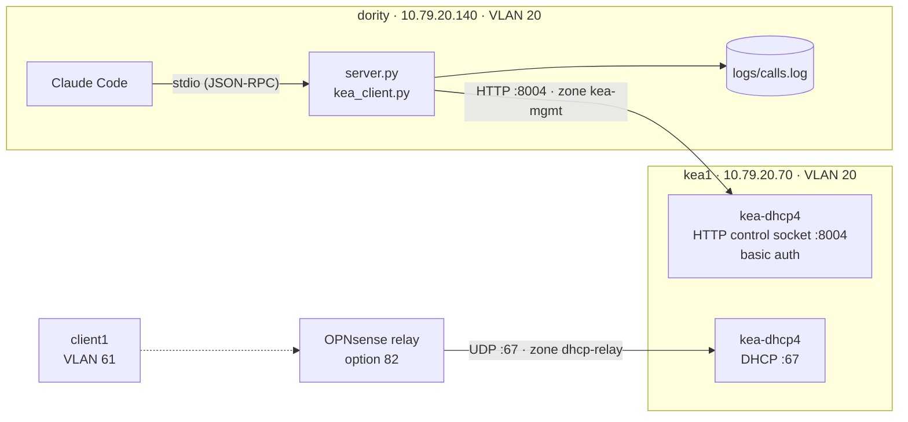

# Kea MCP Server — Read-Only AI Access to Kea's Control API

**Status:** COMPLETE — built and verified 2026-10-18 → 2026-10-19; Kea HA is next, see [Known limitations](#known-limitations)
**Built:** 2026-10-18 → 2026-10-19
**Hosts:** `kea1` (VM 950, swearengen, `10.79.20.70`) · `dority` (MCP host, `10.79.20.140`) · `client1` (VM 951, test subscriber)
**Stack:** ISC Kea 3.0.4 LTS (`kea-dhcp4` HTTP control socket, `lease_cmds` + `stat_cmds` hooks), MCP Python SDK 2.3.0 (`MCPServer`), `httpx2` 2.14.0, `python-dotenv`, Claude Code 2.1
**Builds on:** [KEA-DHCP-LAB.md](KEA-DHCP-LAB.md)
**Purpose:** Let an AI assistant answer operational DHCP questions — "is this subscriber's lease active?", "how full is the pool?", "is Kea healthy?" — through a small MCP server that can read Kea but never change it.

A Python MCP server on `dority` exposes three tools — `lease_lookup`, `pool_utilization`,
`kea_health` — over stdio to Claude Code. Every Kea command passes through an explicit
read-only allowlist in code, every tool call is written to a JSON-lines audit log, and
Kea's API is reachable from exactly one host. End-to-end test: asked *"Is client1's lease
active and how full is the test pool?"*, Claude called two tools and answered correctly —
including that the pool's 1% "utilization" was an out-of-pool reservation, so the pool
was actually empty.

---

## 1. The plain-language version, first

- **MCP (Model Context Protocol) is a standard plug for AI tools.** A server publishes a
  list of tools — name, description, input schema — and an AI client calls them. The
  description is what the model reads to decide which tool fits a question.
- **The server is a translator.** It turns "look up 10.79.61.50" into Kea's JSON API
  command `lease4-get`, and turns Kea's raw lease (epoch timestamps, hex-encoded relay
  data) into fields an operator reads: active or not, expires in 40 minutes, circuit-id.
- **stdio transport means no network listener.** Claude Code starts the server as a
  child process and talks to it over stdin/stdout, like a shell pipe. Nothing new
  listens on a port.
- **Read-only is enforced in code, because Kea can't.** Open-source Kea authenticates
  API callers but has no per-command authorization — any valid credential can delete
  leases or shut Kea down. The server refuses anything not on a five-command allowlist
  before a request is ever built.

---

## 2. Topology



| Item | Value |
|---|---|
| Kea API | `http://10.79.20.70:8004/` — `kea-dhcp4`'s own HTTP control socket (no Control Agent) |
| API user | `mcp-ro`, password file `/etc/kea/kea-api-mcp.pw` (`kea:kea`, 0600) |
| firewalld on kea1 | `kea-mgmt` (source `10.79.20.140/32`: ssh, 8004/tcp) · `dhcp-relay` (sources `10.79.61.0/24`, `10.79.61.1/32`: dhcp) · `public` (eth0: ssh) |
| MCP project | `~/git/kea-mcp` on dority |
| Test data | client1 reserved `10.79.61.50` by circuit-id `olt1-pon61` (remote-id `ont-client1`), outside pool `.100–.199` of subnet id 61 |

---

## 3. Design decisions

1. **stdio, server on dority.** The MCP server runs on the same VLAN as kea1, so Kea's
   API has one allowed source and no traffic crosses OPNsense. stdio opens no ports;
   authorization is "who can run the process." Switching to streamable HTTP for a shared,
   multi-user service is one line (`mcp.run(transport=...)`) — but that service would
   then need its own auth, TLS and Origin checks.
2. **No server-side read-only — so it's enforced in code.** Kea 3.0 open-sourced almost
   every hook, but RBAC (and the Configuration Backend) remain subscriber-only, and
   neither is installed here. Read-only rests on: the allowlist in `kea_client.py`, a
   single-source firewall zone, and credential custody (one 0600 file on one host).
3. **One file talks to Kea.** `kea_client.py` holds the allowlist and is the only code
   that knows Kea's URL and credentials. `server.py` defines tools and never builds a
   request. The security boundary is one short file.
4. **The MCP host gets its own firewalld zone.** A source can be bound to only one
   zone, and source bindings beat interface bindings, so `dority` gets `kea-mgmt`
   (ssh + 8004) rather than sharing a zone with the DHCP relays.
5. **Control socket rebound off loopback with `jq`, validated, swapped, reloaded.**
   Candidate built with `jq`, diffed, checked with `kea-dhcp4 -t`, copied over the live
   file (keeping owner, mode and SELinux label), then `systemctl reload` (SIGHUP). PID
   unchanged — no restart, statistics kept.
6. **Plain HTTP + basic auth on one trusted VLAN (lab).** Production would use Kea's
   `https` socket type with `cert-required: true` (mutual TLS) — the password stops
   crossing the wire in base64 and the client certificate identifies the MCP host.
7. **"Not found" is an answer, not an error.** Kea result 3 becomes `found: false`;
   unreachable Kea, bad credentials and Kea errors become readable tool errors. Each
   failure mode has its own message.
8. **Caveats travel with the numbers.** `pool_utilization` returns its caveats as data,
   so a client can't show "1% used" without the explanation.
9. **Structured output with a schema.** Tools return `dict[str, Any]` with
   `structured_output=True` — clients get typed data plus an output schema, and the SDK
   fails at startup rather than silently falling back to text.
10. **A project `CLAUDE.md` maps lab names to identifiers.** "client1" is a label Kea
    has never heard of; the model can only answer from what the tools can see.
11. **Credentials in a gitignored `.env`, loaded explicitly.** The MCP SDK no longer
    reads `.env` files, so `kea_client.py` loads it from its own directory; variables
    already set in the environment win, which makes failure testing easy.

---

## 4. Step 1 — Transport and placement

| Option | Kea API must accept | New listeners | Verdict |
|---|---|---|---|
| stdio on the Windows desktop | a host on another VLAN, through OPNsense | none | no — cross-VLAN, credentials on a desktop |
| **stdio on dority, Claude Code on dority** | **`10.79.20.140` only** | **none** | **chosen** |
| stdio on dority, Claude Desktop via `ssh` | `10.79.20.140` only | none | optional — SSH keys become the auth layer |
| streamable HTTP on dority | `10.79.20.140` only | one HTTP port | the shared-service pattern; needs real auth + TLS |

### Checkpoint 1 ✅

```bash
python3 --version                       # 3.10+ required by the SDK
python3 -m venv --help >/dev/null && echo "venv OK"
claude --version
```

---

## 5. Step 2 — Kea's API off loopback, scoped to one host (kea1)

### 5.1 Firewall: a zone for the MCP host

```bash
sudo firewall-cmd --permanent --zone=dhcp-relay --remove-source=10.79.20.140/32   # load-test leftover, see §9.1
sudo firewall-cmd --permanent --new-zone=kea-mgmt
sudo firewall-cmd --permanent --zone=kea-mgmt --add-source=10.79.20.140/32
sudo firewall-cmd --permanent --zone=kea-mgmt --add-service=ssh
sudo firewall-cmd --reload
sudo firewall-cmd --get-zone-of-source=10.79.20.140/32    # kea-mgmt
```

### 5.2 Rebind the HTTP control socket

```bash
sudo cp -a /etc/kea/kea-dhcp4.conf /root/kea-dhcp4.conf.known-good-$(date +%F-%H%M)
sudo jq '.Dhcp4["control-sockets"]' /etc/kea/kea-dhcp4.conf        # unix socket + http on 127.0.0.1:8004

sudo jq '(.Dhcp4["control-sockets"][] | select(.["socket-type"]=="http") | .["socket-address"]) = "10.79.20.70"' \
  /etc/kea/kea-dhcp4.conf | sudo tee /etc/kea/kea-dhcp4.conf.candidate >/dev/null
diff <(sudo jq -S . /etc/kea/kea-dhcp4.conf) <(sudo jq -S . /etc/kea/kea-dhcp4.conf.candidate)   # one line
sudo kea-dhcp4 -t /etc/kea/kea-dhcp4.conf.candidate

sudo cp /etc/kea/kea-dhcp4.conf.candidate /etc/kea/kea-dhcp4.conf   # cp onto the file keeps owner/mode/label
sudo rm /etc/kea/kea-dhcp4.conf.candidate
sudo systemctl reload kea-dhcp4                                     # ExecReload = kill -HUP
```

The socket keeps its basic-auth block unchanged:

```json
{ "socket-type": "http", "socket-address": "10.79.20.70", "socket-port": 8004,
  "authentication": { "type": "basic", "realm": "kea-dhcp4", "directory": "/etc/kea",
                      "clients": [ { "user": "mcp-ro", "password-file": "kea-api-mcp.pw" } ] } }
```

### 5.3 Open 8004 to the MCP host only

```bash
sudo firewall-cmd --permanent --zone=kea-mgmt --add-port=8004/tcp
sudo firewall-cmd --reload
sudo firewall-cmd --zone=public --list-ports      # empty
```

### Checkpoint 2 ✅

```bash
# kea1
sudo ss -ltnp 'sport = :8004'                      # 10.79.20.70:8004, same PID as before the reload
ps -eZ | grep kea-dhcp4                            # unconfined_service_t (no policy covers Kea)
sudo ausearch -m AVC,USER_AVC,SELINUX_ERR -ts today -i     # <no matches>
ls /usr/lib64/kea/hooks/ | grep -iE 'rbac|cb_cmds' || echo "no RBAC/CB hooks"

# dority — right password, then wrong password
curl -s -u "mcp-ro:$KEA_PW" -H 'Content-Type: application/json' \
  -d '{"command":"version-get"}' http://10.79.20.70:8004/ | jq '.[0].result, .[0].text'   # 0, "3.0.4"
curl -s -o /dev/null -w '%{http_code}\n' -u 'mcp-ro:wrong' -H 'Content-Type: application/json' \
  -d '{"command":"version-get"}' http://10.79.20.70:8004/                                 # 401

# any other host
curl -s -m 3 -o /dev/null -w '%{http_code}\n' http://10.79.20.70:8004/                    # 000
```

---

## 6. Step 3 — Project layout (dority)

```
~/git/kea-mcp/
├── .gitignore         .venv/ .env logs/ __pycache__/ *.pyc
├── .env.example       variable names, no values (committed)
├── .env               real values, 0600, gitignored
├── .sanitizerc        pre-commit sanitizer profile (private IPs allowed)
├── requirements.txt   mcp>=2,<3 · python-dotenv>=1,<2
├── requirements.lock  pip freeze of what was tested
├── CLAUDE.md          lab glossary for Claude Code
├── kea_client.py      allowlist + the only code that talks to Kea
├── server.py          the three MCP tools + audit log
├── smoke.sh           stdio test client in Bash
└── logs/calls.log     audit log, 0600, gitignored
```

```bash
mkdir -p ~/git/kea-mcp && cd ~/git/kea-mcp && git init
python3 -m venv .venv && . .venv/bin/activate
python -m pip install --upgrade pip
pip install -r requirements.txt && pip freeze > requirements.lock
```

`.env`, written without the password reaching shell history:

```bash
read -rsp 'mcp-ro password: ' KEA_PW; echo
( umask 077
  cat > .env <<EOF
KEA_URL=http://10.79.20.70:8004/
KEA_USER=mcp-ro
KEA_PASSWORD='${KEA_PW}'
KEA_TIMEOUT=5
EOF
)
unset KEA_PW
```

### Checkpoint 3 ✅

```bash
python -c "import importlib.metadata as m; print('mcp', m.version('mcp'))"            # 2.3.0
python -c "from mcp.server.mcpserver import MCPServer; print('MCPServer import OK')"
python -c "from dotenv import dotenv_values as d; c=d('.env'); print(sorted(c), bool(c.get('KEA_PASSWORD')))"
stat -c '%a %n' .env                 # 600
git check-ignore -v .env logs/       # both ignored
```

---

## 7. Step 4 — Client, then tools, one at a time

### 7.1 `kea_client.py` — the security boundary

The allowlist is checked before anything else:

```python
ALLOWED_COMMANDS = frozenset({
    "lease4-get",
    "lease4-get-by-hw-address",
    "stat-lease4-get",
    "status-get",
    "version-get",
})

def call(command, arguments=None):
    if command not in ALLOWED_COMMANDS:
        raise KeaError(f"'{command}' is not on the read-only allowlist; refusing to send it.")
    ...
    resp = httpx2.post(url, json=body, auth=(user, password), timeout=timeout)
```

Then, in order: transport errors (timeout, connect) become plain sentences; HTTP 401
gets its own message; the reply is unwrapped (a one-element list normally, a bare object
for HTTP-level errors); Kea result 0 returns, 3 raises `KeaNotFound`, 2 points at a
missing hook library, anything else raises `KeaError`. The password never appears in
any message.

#### Checkpoint 4a ✅

```bash
python - <<'EOF'
import kea_client as k
print(k.call("version-get")["text"])                                  # 3.0.4
for cmd in ("lease4-del", "config-get", "shutdown"):
    try: k.call(cmd)
    except k.KeaError as e: print("REFUSED:", e)                      # never sent
try: k.call("lease4-get", {"ip-address": "10.79.61.250"})
except k.KeaNotFound as e: print("NOT FOUND:", e)
EOF

KEA_PASSWORD=wrong python -c "import kea_client as k; k.call('version-get')" 2>&1 | tail -1              # 401 message
KEA_URL=http://10.79.20.70:8005/ python -c "import kea_client as k; k.call('version-get')" 2>&1 | tail -1 # connect (firewall reject)
KEA_TIMEOUT=3 KEA_URL=http://10.79.20.71:8004/ python -c "import kea_client as k; k.call('version-get')" 2>&1 | tail -1  # no host
```

### 7.2 `server.py` — audit log and tools

Every tool body runs inside `with audit(tool, **args)`, a context manager that writes
one JSON line per call (UTC timestamp, tool, arguments, outcome, milliseconds) and maps
failures:

| Outcome | Cause | What the client sees |
|---|---|---|
| `ok` | answered | the result |
| `not_found` | Kea result 3 | `found: false` and a message |
| `rejected` | input failed validation | tool error; Kea never contacted |
| `error` | Kea unreachable, auth, Kea error | tool error with the readable message |
| `bug` | unexpected Python exception | re-raised |

| Tool | Kea commands | Returns |
|---|---|---|
| `kea_health()` | `status-get`, `version-get` | version, PID, uptime, time since last reload, socket state, DHCP enabled/DISABLED with reason, multi-threading and packet-queue depth, one-line summary |
| `lease_lookup(ip_or_mac)` | `lease4-get` or `lease4-get-by-hw-address` | per lease: IP, hardware address, hostname, subnet, state, `active` (state default *and* not past expiry), expiry, relay info decoded from option 82 |
| `pool_utilization(subnet_id=None)` | `stat-lease4-get`, `status-get` | per subnet: pool size, assigned, declined, percent; counter age; caveats |

Input validation in `lease_lookup`: IPv4 via Python's `ipaddress`, otherwise a hardware
address in colon, dash, Cisco-dotted or bare-hex form, normalized to colon form. Anything
else is rejected before Kea is contacted.

Relay info: with `store-extended-info`, Kea keeps option 82 in the lease's
`user-context` (`ISC.relay-agent-info.sub-options`) as a hex string of sub-options —
code (1 byte), length (1 byte), value — repeated. Sub-option 1 is circuit-id, 2 is
remote-id; printable values are shown as text, others as hex.

Server construction and transport:

```python
from mcp.server.mcpserver import MCPServer      # SDK 2.x name for FastMCP
mcp = MCPServer("kea-mcp", version="0.2.0", instructions="Read-only access to a Kea DHCPv4 server ...")

@mcp.tool(structured_output=True)
def kea_health() -> dict[str, Any]: ...

mcp.run(transport="stdio")
```

### 7.3 `smoke.sh` — an MCP client in Bash

A stdio MCP session is JSON lines: `initialize`, `notifications/initialized`, then
requests. `smoke.sh TOOL [ARGS-JSON]` sends that sequence and pipes stdout through `jq`
— any non-JSON line on stdout makes `jq` fail, which proves the protocol stream stays
clean.

#### Checkpoint 4b–4d ✅

```bash
S() { ./smoke.sh "$@" | tail -1 | jq '.result.structuredContent // .result'; }
./smoke.sh kea_health | sed -n 2p                       # all three tools listed
S kea_health | jq .summary                              # "Kea 3.0.4, up 1d 5h 32m, sockets ready, DHCP enabled"
S lease_lookup '{"ip_or_mac":"10.79.61.50"}'            # active, circuit_id olt1-pon61, remote_id ont-client1
S lease_lookup '{"ip_or_mac":"10.79.61.250"}'           # found: false
S lease_lookup '{"ip_or_mac":"not-a-thing"}'            # isError; outcome rejected, 0 ms
S pool_utilization '{"subnet_id": 61}'                  # pool 100, assigned 1, 1.0%
S pool_utilization '{"subnet_id": 999}'                 # found: false
KEA_PASSWORD=wrong ./smoke.sh kea_health | tail -1 | jq .result   # isError, 401 message
jq -c '{tool, args, outcome, ms}' logs/calls.log | tail -8         # ok / not_found / rejected
```

---

## 8. Step 5 — Claude Code

```bash
claude mcp add kea -- /home/aba/git/kea-mcp/.venv/bin/python /home/aba/git/kea-mcp/server.py
claude mcp list                     # kea: connected
cd ~/git/kea-mcp && claude          # /mcp → kea · connected · 3 tools
```

`CLAUDE.md` in the project directory gives the model the lab's names:

```markdown
- client1 is the test subscriber: reserved 10.79.61.50 by circuit-id
  olt1-pon61 (remote-id ont-client1). The reservation is outside the pool.
- The test pool is subnet id 61: 10.79.61.0/24, pool .100-.199.
```

### Checkpoint 5 ✅ — the test question

> *Is client1's lease active and how full is the test pool?*

Claude called `lease_lookup("10.79.61.50")` and `pool_utilization(61)` and answered:
lease **active**, 1 h lease with ~40 minutes left, relay info matching the expected
subscriber (circuit-id `olt1-pon61`, remote-id `ont-client1`); test pool **effectively
empty** — the tool reports 1 of 100 assigned, but that one lease is the `.50`
reservation outside the `.100–.199` pool, so in-pool use is 0/100; counters date from
Kea's process start.

The audit log shows both calls two seconds apart:

```bash
tail -2 ~/git/kea-mcp/logs/calls.log | jq -c '{ts, tool, args, outcome}'
```

---

## 9. Incidents and corrections

### 9.1 SSH from the MCP host rejected — "No route to host"

**Symptom:** `ssh 10.79.20.70` from dority: *No route to host*, with kea1 up.
**Diagnosis:** `tcpdump` showed the SYN leave and an ICMP *admin prohibited filter*
come back; ARP resolved normally. A firewall reject, not routing.
**Cause:** `10.79.20.140/32` was still a source in the `dhcp-relay` zone from the
perfdhcp load test (dority played the relay). Source bindings win over interface
bindings, so dority landed in a zone that allows only `dhcp`.
**Fix:** removed it from `dhcp-relay`; created `kea-mgmt` for the MCP host (§5.1).

### 9.2 Correct password rejected with 401

**Symptom:** `curl` from dority with the typed password: 401.
**Diagnosis on kea1, without printing the secret:** `tail -c1 … | od -c` showed no
trailing newline in the password file; `curl -u "mcp-ro:$(sudo cat …)"` returned
result 0. File and Kea were fine — the typed value was wrong.
**Fix:** copied the real value via `ssh -t kea1 'sudo cat …'` into the password manager.
**Found along the way:** Kea logged neither failed attempt at default log level (§11).

### 9.3 `FastMCP` no longer exists

**Cause:** MCP Python SDK 2.0 (2026-07-28) moved `mcp.server.fastmcp` to
`mcp.server.mcpserver`, renamed the class `MCPServer`, moved transport options to
`run()`, and stopped reading `.env` files.
**Fix:** written against 2.x from the start; `mcp>=2,<3` pinned; `.env` loaded
explicitly with `python-dotenv`.

### 9.4 client1's lease not found

**Symptom:** `lease4-get 10.79.61.50` → result 3.
**Cause:** client1 (VM 951) was powered off. The lease expired, Kea reclaimed it, and
after `hold-reclaimed-time` it was flushed from the database. Kea was right.
**Fix:** `qm start 951`; the client re-ran DORA through the relay onto its reservation.

### 9.5 `structuredContent` was null

**Cause:** a bare `-> dict` return annotation isn't turned into an output schema.
**Fix:** `-> dict[str, Any]` plus `@mcp.tool(structured_output=True)`.

### 9.6 Pre-commit sanitizer blocked `server.py`

**Cause:** format examples in two docstrings matched the hardware-address pattern.
**Fix:** reworded the docstrings in prose. No `--no-verify`.

---

## 10. Gotchas

1. **Kea's HTTP API needs `Content-Type: application/json`** — without it, Kea answers
   400 before checking credentials.
2. **Replies are a list, except HTTP-level errors.** Normal replies are a one-element
   array; a 401 is a bare object. Handle both.
3. **Result codes:** 0 ok, 1 error, 2 unsupported (usually a missing hook), 3 empty /
   not found.
4. **A firewalld source can be in only one zone**, and source bindings beat interface
   bindings. Check `firewall-cmd --get-zone-of-source` before assuming a rule applies.
5. **`kea-dhcp4 -t` doesn't open the lease database.** It passed with the pgsql hook
   loaded and closed again; a broken database section can still pass.
6. **`systemctl reload` rebinds the HTTP control socket in place** — same PID, counters
   kept.
7. **`/etc/kea` is not readable by normal users** — `ls` needs `sudo`.
8. **`ausearch -ts recent` means the last 10 minutes.** Use `-ts today` for older events.
9. **stdio: nothing may write to stdout except the protocol.** One `print()` corrupts
   the JSON-RPC stream. Logging goes to a file or stderr.
10. **httpx2 logs every request at INFO on stderr** — raise `httpx2` and `httpcore2`
    loggers to WARNING.
11. **`total-addresses` counts the pool; `assigned-addresses` counts every lease in the
    subnet.** Out-of-pool reservations inflate "utilization" — subnet 61 shows 1% with an
    empty pool.
12. **Lease statistics reset when Kea restarts.**
13. **`python-dotenv` doesn't override variables already in the environment** — handy
    for failure tests (`KEA_PASSWORD=wrong ./smoke.sh …`).
14. **Claude Code in auto mode doesn't prompt per tool call.** Read-only-by-design is
    what makes auto-approval safe here; don't count on prompts as a control.
15. **`claude mcp add` defaults to local scope** — stored in `~/.claude.json` for that
    project directory, not in the repo.

---

## 11. Known limitations

- **No server-side authorization.** Any holder of the `mcp-ro` password can run any
  Kea command; read-only exists only in `kea_client.py`. Production: Kea's RBAC hook.
- **Basic auth over plain HTTP** on a single trusted VLAN. Production: `https` socket
  with mutual TLS.
- **Kea doesn't log failed API logins** at default log level. The MCP audit log is the
  only record of who asked what.
- **Single Kea server.** No HA yet — if kea1 is down, `kea_health` reports it and
  nothing else answers.
- **Subscriber names come from a glossary.** The tools look up by IP or hardware
  address; mapping "client1" relies on `CLAUDE.md`. A production version would look up
  by circuit-id or remote-id.
- **stdio is single-user.** A shared service needs streamable HTTP with real auth.
- **Audit log isn't rotated.**
- **Utilization overstates pool use** when reservations sit outside the pool; the
  caveat is reported, not corrected.

---

## Quick reference

| | |
|---|---|
| Kea API test | `curl -s -u "mcp-ro:$KEA_PW" -H 'Content-Type: application/json' -d '{"command":"version-get"}' http://10.79.20.70:8004/ \| jq .` |
| Listener / zone | `sudo ss -ltnp 'sport = :8004'` · `sudo firewall-cmd --get-zone-of-source=10.79.20.140/32` |
| Config change | `jq` → `.candidate` → `diff` → `kea-dhcp4 -t` → `cp` over live → `systemctl reload kea-dhcp4` |
| Project | `cd ~/git/kea-mcp && . .venv/bin/activate` |
| Smoke test | `./smoke.sh <tool> '<args-json>' \| tail -1 \| jq '.result.structuredContent // .result'` |
| Audit log | `jq -c '{ts, tool, args, outcome, ms}' logs/calls.log \| tail` · errors: `jq 'select(.outcome=="error")' logs/calls.log` |
| Claude Code | `claude mcp list` · `/mcp` in a session |
| Allowlist | `ALLOWED_COMMANDS` in `kea_client.py` — adding a command is a security decision |
