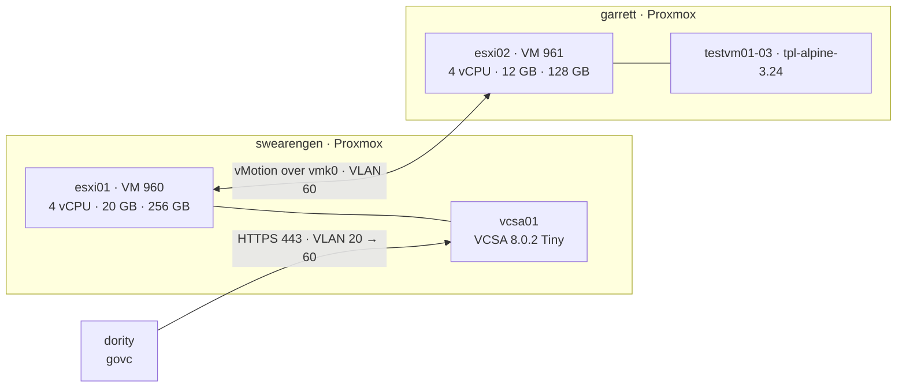

# Nested vSphere 8 Lab — ESXi and vCenter on Proxmox

**Status:** CORE COMPLETE — Steps 1–9 built and verified 2026-10-18 (including a VMware → Proxmox migration); NFS/HA and the CPU-model fix are open, see [§12](#12-still-ahead)
**Built:** 2026-10-16 (first attempt) · 2026-10-17 → 2026-10-18
**Hosts:** `esxi01` (VM 960, swearengen), `esxi02` (VM 961, garrett), `vcsa01` (VCSA Tiny on `esxi01`), `dority` as the automation workstation
**Stack:** ESXi 8.0.2 (build 22380479), vCenter Server Appliance 8.0.2 (build 22617221), `govc` (govmomi), Alpine Linux 3.24 test guests
**Licensing:** evaluation mode only — no license keys applied (60-day full-feature evaluation)
**Purpose:** Refresh hands-on vSphere operations on current versions: install, vCenter deployment, clustering, distributed switching, vMotion, templates — scripted where it makes sense. Lab only; nothing here carries real workloads.

A two-host vSphere 8 cluster running nested on two Proxmox hosts with different
CPU generations. vCenter is deployed from a JSON template with the CLI installer,
the inventory is built with `govc`, VMs move between hosts with shared-nothing
vMotion at zero packet loss, and test guests are deployed from a generalized
template. Two of those guests are then migrated off vSphere onto Proxmox with
Proxmox's native ESXi importer, from the CLI. Along the way: a nested CPU-feature
kernel panic traced to XSAVE — and confirmed by the migration, when the workaround
was no longer needed one hypervisor layer down.

---

## 1. The plain-language version, first

- **ESXi is the hypervisor; vCenter is the management plane.** Each ESXi host runs
  VMs on its own. vCenter ties hosts into a cluster so VMs can move between them,
  restart elsewhere when a host dies, and share one network definition.
- **"Nested" means hypervisors inside a hypervisor.** Proxmox runs the ESXi hosts
  as VMs, and ESXi runs its own VMs inside them. Cheap to build; it also exposes
  edge cases that real hardware hides — this lab hit one (see [§9.3](#93-guest-kernel-panic-in-fpstate_reset-xsave)).
- **vMotion moves a running VM between hosts.** Memory is copied while the VM
  keeps running, then a sub-second pause hands it over. With no shared storage,
  the disk moves too ("shared-nothing vMotion").
- **A distributed switch (vDS) is one switch definition for every host.** vCenter
  owns the configuration and pushes it down; hosts keep forwarding even if vCenter
  is down.
- **A template is a "golden image" VM that can't be powered on**, only deployed
  from — after removing anything that must be unique per machine.

---

## 2. Topology



Every ESXi vNIC is a **trunk** (`trunks=20;60;62`, no access tag). ESXi does the
VLAN tagging itself, the way a physical host on a switch trunk would.

| Item | Value |
|---|---|
| Lab VLAN | 60 `LAB`, `10.79.60.0/24`, gateway `10.79.60.1` on OPNsense |
| `vcsa01` | `10.79.60.10` — `vcsa01.greenbean.org` |
| `esxi01` | `10.79.60.11` — VM 960 on swearengen |
| `esxi02` | `10.79.60.12` — VM 961 on garrett |
| `testvm01` / `testvm02` | `10.79.60.20` / `10.79.60.21` (static) — now Proxmox VMs 970 / 971 on garrett; ESXi originals powered off as rollback |
| DNS / NTP | Pi-holes `10.79.10.250`, `10.79.10.249` (A + PTR for all three) · NTP `10.79.60.1` |
| Inventory | `greenbean-dc` → `lab-cluster` → `esxi01`, `esxi02`; folders `infra`, `templates` |
| Datastores | `esxi01-local` (~240 GB), `esxi02-local` (~112 GB) — VMFS-6, local |
| Networking | `vSwitch0` (vmnic0): `Management Network` VLAN 60, `Lab-VLAN60` · `lab-vds` (vmnic1): `dpg-lab-60` VLAN 60 |
| SSO domain | `vsphere.local` (`administrator@vsphere.local`) |

---

## 3. Design decisions

1. **Nested on swearengen and garrett, never `wu`.** `wu` is the house router
   (OPNsense) and DNS host; lab load stays off it.
2. **One CPU model on both hosts.** swearengen is Comet Lake, garrett is Kaby Lake.
   Both ESXi VMs use the same custom QEMU model (`Skylake-Client-noTSX-IBRS` + `vmx`),
   so every guest sees an identical CPU and vMotion works without EVC — the same
   principle as EVC, applied one layer down.
3. **Trunked vNICs with the Proxmox firewall off** (`firewall=0`). Proxmox's
   firewall filters by MAC; nested guests use MACs Proxmox has never heard of.
4. **Management on a standard switch (vmnic0), VM traffic on the vDS (vmnic1).**
   A vDS mistake can't cut vCenter off from its hosts.
5. **Single lab VLAN; vMotion shares vmk0.** Two vmks in one subnet make ESXi pick
   egress ambiguously, so vMotion is tagged on the management vmk. Production would
   use a dedicated VLAN, the vMotion TCP/IP stack, and jumbo frames.
6. **OSData capped at 8 GB** (`autoPartitionOSDataSize=8192`). ESXi 8 otherwise
   reserves up to 128 GB of the boot disk, leaving too little VMFS for VCSA.
7. **VCSA on local storage.** Keeps the management plane off NFS, so a TrueNAS
   reboot can't take vCenter down with it.
8. **CLI installer, JSON template, prompted passwords.** Repeatable, and the
   template holds no secrets — safe to keep in version control.
9. **`govc` runs on `dority`, not a Proxmox host.** Hypervisor hosts stay clean;
   tooling lives on the dev box. `dority` only needs HTTPS to vCenter — vCenter
   talks to the hosts itself.
10. **Evaluation mode only.** Every feature is unlocked for 60 days; no keys applied.

---

## 4. Step 1 — Proxmox preparation

```bash
cat /sys/module/kvm_intel/parameters/nested     # Y on both hosts
cat /etc/pve/virtual-guest/cpu-models.conf      # identical on both (unclustered → copied by hand)
```

```
cpu-model: esxi-nested
    flags +vmx
    reported-model Skylake-Client-noTSX-IBRS
```

VM settings (esxi01; esxi02 identical except memory and disk size):

| Setting | Value | Why |
|---|---|---|
| `ostype` / `machine` | `other` / `q35` | |
| `bios` | `ovmf`, efidisk `pre-enrolled-keys=0` | UEFI without Secure Boot keys keeps nested boot simple |
| `cpu` | `custom-esxi-nested`, 4 cores | exposes VT-x; common baseline (§3.2) |
| `memory` / `balloon` | 20480 (esxi02: 12288) / `0` | ESXi has no balloon driver |
| disk | `sata0`, `ssd=1,discard=on` | ESXi 8 detects none of QEMU's SCSI controllers, PVSCSI included (§9.7) |
| NICs | 2× `vmxnet3`, `trunks=20;60;62`, `firewall=0` | §3.3 |

Wipe leftovers from earlier attempts before installing (VM stopped):

```bash
DISK=$(pvesm path local-lvm:vm-960-disk-1)
lvchange -ay ${DISK#/dev/}
blkdiscard -fv $DISK                 # -f required: an old GPT was present
wipefs $DISK                         # no output = clean
qm set 960 --delete efidisk0         # also clear stale UEFI boot entries
qm set 960 --efidisk0 local-lvm:1,efitype=4m,pre-enrolled-keys=0
```

On thin LVM, `blkdiscard` returns the blocks to the pool (Data% → 0) in seconds.
The EFI disk is recreated rather than discarded — discarding it would leave OVMF
with no variable store.

**RAM budget (swearengen, 46 GiB):** 21 GiB available before the lab; with VCSA
warmed up, ~6 GiB remained. VCSA Tiny alone takes 14 GB inside `esxi01`.

---

## 5. Step 2 — ESXi installation

At the installer's boot screen, **Shift+O** and append:

```
autoPartitionOSDataSize=8192 allowLegacyCPU=true
```

(`allowLegacyCPU` only if the installer warns about the CPU.) The red
`late-filesystems activation failed` / `non-persistent storage` lines during
installer boot are expected — it runs from RAM with no disk yet.

After install, eject the ISO from Proxmox (`qm set 960 --ide2 none,media=cdrom`)
and configure in the DCUI (F2 → Configure Management Network): vmnic0 only,
**VLAN 60**, static IPv4, both Pi-holes, FQDN hostname, IPv6 off; enable SSH and
the ESXi Shell under Troubleshooting Options.

### Checkpoint 2 ✅ — both hosts verified over SSH

```bash
esxcli system version get                        # 8.0.2, build 22380479
esxcli system hostname get                       # FQDN correct
esxcli network nic list                          # vmnic0/1, nvmxnet3, Link Up
esxcli network vswitch standard portgroup list   # Management Network → VLAN 60
esxcli network ip interface ipv4 get             # vmk0 STATIC
esxcli storage filesystem list                   # datastore1 ~240 GB / ~112 GB; OSDATA 8.3 GB
vim-cmd vimsvc/license --show                    # Evaluation Mode, expires +60 days
vmkping -I vmk0 esxi02.greenbean.org             # host-to-host L2 across the CRS310
esxcli system ntp set --server=10.79.60.1 --enabled=true
```

`vmkping -I <vmk>` pings out of a specific VMkernel interface — the basic tool
for troubleshooting vMotion and storage networks.

---

## 6. Step 3 — vCenter with the CLI installer

VM port group first. `VM Network` is VLAN 0; VCSA deployed there would land on the
trunk's native VLAN and never reach its gateway. On **both** hosts (same name —
vMotion matches port groups by name):

```bash
esxcli network vswitch standard portgroup add -p "Lab-VLAN60" -v vSwitch0
esxcli network vswitch standard portgroup set -p "Lab-VLAN60" --vlan-id 60
```

Mount the ISO with explicit permissions (see [§9.4](#94-installer-iso-mounted-without-execute-bits)), from swearengen:

```bash
mount -o loop,ro,mode=0555,dmode=0555 /var/lib/vz/template/iso/<vcsa-8.0.2>.iso /mnt/vcsa
```

`/root/vcsa/vcsa01.json` (passwords left empty — the installer prompts for them):

```json
{
  "__version": "2.13.0",
  "new_vcsa": {
    "esxi": { "hostname": "esxi01.greenbean.org", "username": "root", "password": "",
              "deployment_network": "Lab-VLAN60", "datastore": "datastore1" },
    "appliance": { "thin_disk_mode": true, "deployment_option": "tiny", "name": "vcsa01" },
    "network": { "ip_family": "ipv4", "mode": "static", "system_name": "vcsa01.greenbean.org",
                 "ip": "10.79.60.10", "prefix": "24", "gateway": "10.79.60.1",
                 "dns_servers": ["10.79.10.250", "10.79.10.249"] },
    "os": { "password": "", "ntp_servers": "10.79.60.1", "ssh_enable": true },
    "sso": { "password": "", "domain_name": "vsphere.local" }
  },
  "ceip": { "settings": { "ceip_enabled": false } }
}
```

```bash
python3 -m json.tool /root/vcsa/vcsa01.json > /dev/null && echo "JSON OK"
cd /mnt/vcsa/vcsa-cli-installer/lin64
./vcsa-deploy install --accept-eula --no-ssl-certificate-verification --verify-template-only /root/vcsa/vcsa01.json
./vcsa-deploy install --accept-eula --no-ssl-certificate-verification --precheck-only       /root/vcsa/vcsa01.json
tmux new -s vcsa
./vcsa-deploy install --accept-eula --no-ssl-certificate-verification --log-dir /root/vcsa/logs /root/vcsa/vcsa01.json
```

- Password policy enforced at the prompt: **8–20 characters**, upper, lower,
  digit, special, no spaces.
- `--precheck-only` logs into the target host and checks datastore space, port
  group and DNS without deploying anything.
- Run inside `tmux` so a dropped SSH session doesn't kill the install.

### Checkpoint 3 ✅ — deployed in 12 minutes

Stage 1 (OVA → `esxi01`) and stage 2 (services) completed 23:39 → 23:51 UTC.
VAMI at `https://vcsa01.greenbean.org:5480`, vSphere Client at `/ui`, licensing
in Evaluation Mode.

---

## 7. Step 4 — Inventory with govc

On `dority`:

```bash
curl -L -o - "https://github.com/vmware/govmomi/releases/latest/download/govc_$(uname -s)_$(uname -m).tar.gz" \
  | sudo tar -C /usr/local/bin -xvzf - govc
```

`~/.govc-lab` holds everything except the password:

```bash
export GOVC_URL=vcsa01.greenbean.org
export GOVC_USERNAME=administrator@vsphere.local
export GOVC_INSECURE=1                      # self-signed lab certificate
export GOVC_DATACENTER=greenbean-dc
```

```bash
source ~/.govc-lab
read -rs -p "SSO password: " GOVC_PASSWORD; export GOVC_PASSWORD; echo
govc about

govc datacenter.create greenbean-dc
govc cluster.create lab-cluster
read -rs -p "ESXi root password: " ESXPW; echo
for h in esxi01 esxi02; do
  govc cluster.add -cluster lab-cluster -hostname $h.greenbean.org \
    -username root -password "$ESXPW" -noverify
done
unset ESXPW

govc folder.create /greenbean-dc/vm/infra
govc object.mv "/greenbean-dc/vm/Discovered virtual machine/vcsa01" /greenbean-dc/vm/infra
govc object.destroy "/greenbean-dc/vm/Discovered virtual machine"

govc object.rename "/greenbean-dc/datastore/datastore1"     esxi01-local
govc object.rename "/greenbean-dc/datastore/datastore1 (1)" esxi02-local
```

- `read -rs` keeps passwords out of shell history and off the screen.
- `-noverify` accepts host SSL thumbprints unchecked — lab only.
- vCenter parks pre-existing VMs in `Discovered virtual machine` when it adds a
  host; `vcsa01` landed there because it was already running on `esxi01`.
- The `vCLS` folder holds vSphere Cluster Services agent VMs, created
  automatically to keep DRS/HA working independently of vCenter. Left alone.

### Checkpoint 4 ✅ — both hosts added in six seconds

---

## 8. Steps 5–9

### 8.1 Step 5 — Distributed switch and vMotion ✅

```bash
govc dvs.create -folder /greenbean-dc/network lab-vds
govc dvs.add -dvs lab-vds -pnic vmnic1 esxi01.greenbean.org esxi02.greenbean.org
govc dvs.portgroup.add -dvs lab-vds -type earlyBinding -vlan 60 dpg-lab-60
```

vMotion on vmk0, both hosts (§3.5):

```bash
esxcli network ip interface tag add -i vmk0 -t VMotion
esxcli network ip interface tag get -i vmk0      # Tags: VMotion, Management
```

### 8.2 Step 6 — Test guest ✅

```bash
govc vm.create -host esxi02.greenbean.org -ds esxi02-local \
  -net dpg-lab-60 -net.adapter vmxnet3 \
  -m 1024 -c 1 -g otherLinux64Guest -disk 8GB -on=false testvm01
```

Alpine **standard** ISO (not `virt` — the full kernel carries every storage and NIC
driver), uploaded with `govc datastore.upload`, attached with
`govc device.cdrom.add/insert/connect`. First boot panicked
([§9.3](#93-guest-kernel-panic-in-fpstate_reset-xsave)); booted with `noxsave`, installed in `sys` mode, then
made `noxsave` permanent before the first disk boot:

```bash
mount /dev/sda3 /mnt && mount /dev/sda1 /mnt/boot
sed -i 's/^default_kernel_opts="/&noxsave /' /mnt/etc/update-extlinux.conf   # survives kernel updates
sed -i '/^[[:space:]]*APPEND/ s/$/ noxsave/' /mnt/boot/extlinux.conf         # current entry
umount /mnt/boot /mnt
```

VMware Tools (community repo; the `guestinfo` plugin is what reports the IP):

```bash
sed -i 's|^#\(.*/community\)$|\1|' /etc/apk/repositories && apk update
apk add open-vm-tools open-vm-tools-guestinfo
rc-update add open-vm-tools default && rc-service open-vm-tools start
```

### 8.3 Step 7 — Shared-nothing vMotion ✅

```bash
ping -D 10.79.60.20                                                          # shell 1
time govc vm.migrate -host esxi01.greenbean.org -ds esxi01-local testvm01   # shell 2
time govc vm.migrate -host esxi02.greenbean.org -ds esxi02-local testvm01
```

| Direction | Time | Packet loss |
|---|---|---|
| esxi02 → esxi01 (compute + storage) | 10.0 s | 0 |
| esxi01 → esxi02 (compute + storage) | 9.3 s | 0 |

40 pings, 0 lost. The switchover shows as ping intervals stretching from 1.000 s
to ~1.024 s (the brief stun while final memory pages copy) and RTT spikes to
6–13 ms. Fast because the thin disk held only a few hundred MB and memory was 1 GB.

### 8.4 Step 8 — Template and clones ✅

Generalize, then clone to a template (keeps `testvm01`; `vm.markastemplate`
would convert it in place):

```bash
# in testvm01
rm -f /etc/ssh/ssh_host_* /root/.ash_history && poweroff
# on dority
govc folder.create /greenbean-dc/vm/templates
govc vm.clone -vm testvm01 -template=true -host esxi02.greenbean.org -ds esxi02-local \
  -folder /greenbean-dc/vm/templates -on=false tpl-alpine-3.24
govc vm.clone -vm /greenbean-dc/vm/templates/tpl-alpine-3.24 \
  -host esxi02.greenbean.org -ds esxi02-local -net dpg-lab-60 -on=true testvm02
```

Re-addressed `testvm02` while `testvm01` stayed off (static IPs, no conflict):

```bash
sed -i 's/10\.79\.60\.20/10.79.60.21/' /etc/network/interfaces
sed -i 's/testvm01/testvm02/g' /etc/hostname /etc/hosts
hostname -F /etc/hostname && rc-service networking restart
```

Verified: unique host keys generated on first boot, `noxsave` carried over with
the disk, both guests reachable. Linked clone from a snapshot:

```bash
govc snapshot.create -vm testvm02 base
govc vm.clone -vm testvm02 -snapshot base -link -on=false \
  -host esxi02.greenbean.org -ds esxi02-local testvm03
govc datastore.ls -l -ds esxi02-local testvm03/      # the clone's own files
```

The clone's own disk is **1.0 MB** against ~450 MB written in the parent. govc's
`vm.info` "committed" figure (449 MB) counts the shared parent it reads from, so
check the datastore listing for a linked clone's real footprint.

### 8.5 Step 9 — Migrate VMware → Proxmox ✅

Cold migration of `testvm01` → VM **970** and `testvm02` → VM **971**, onto
**garrett** (swearengen carries TrueNAS and Plex, so migration load stays off it),
using Proxmox's native ESXi import (`pve-esxi-import-tools` 1.0.1, PVE 9.2) — all
from the CLI.

**Pre-migration (vSphere side):**

```bash
govc vm.destroy testvm03                    # linked clone depending on testvm02's snapshot
govc snapshot.remove -vm testvm02 base      # importer doesn't want snapshot chains
govc snapshot.tree -vm testvm02             # empty
```

In each guest — confirm it can boot on VirtIO, record identity. Nothing else is
changed on the source, so it stays a clean rollback copy:

```bash
grep ^features /etc/mkinitfs/mkinitfs.conf  # features="ata base ide scsi usb virtio ext4"
ip addr show eth0 | grep -E 'ether|inet '   # VMware MAC (00:50:56 OUI) + .20 / .21 — recorded off-repo
```

The Linux equivalent of injecting VirtIO drivers into a Windows guest before
migrating: if the initramfs lacks the virtio storage driver, the VM boots on
Proxmox and can't find its root disk.

**Cutover** — clean guest shutdown via VMware Tools, at 05:52:15:

```bash
govc vm.power -s testvm01 testvm02
govc vm.info testvm01 testvm02 | grep -E 'Name:|Power state'   # repeat — shutdown is asynchronous
```

**Import (garrett):**

```bash
read -rs -p "ESXi root password: " ESXPW; echo
pvesm add esxi esxi02 --server esxi02.greenbean.org --username root \
  --password "$ESXPW" --skip-cert-verification 1
unset ESXPW
pvesm list esxi02          # esxi02:ha-datacenter/esxi02-local/testvm01/testvm01.vmx …

time qm import 970 'esxi02:ha-datacenter/esxi02-local/testvm01/testvm01.vmx' --storage local-lvm
```

What the importer produced by default — a faithful copy of the VMware hardware:

```
bios: seabios
boot: order=ide0;scsi0
ide0: none,media=cdrom
memory: 1024
net0: vmxnet3=<source-mac>             ← VMware NIC model and original MAC kept
ostype: l26                            ← guest OS detected from the .vmx
scsi0: local-lvm:vm-970-disk-0,size=8G
scsihw: lsi                            ← LSI emulation, matching the source controller
smbios1: uuid=f1501542-1ee0-5702-…     ← derived from the VMware UUID 421550f1-e01e-0257-…
```

Keeping the MAC and an LSI controller makes the first boot safe even for a guest
without VirtIO drivers. The SMBIOS UUID is the VMware BIOS UUID with the first
three fields byte-swapped (VMware and SMBIOS disagree on endianness), so
UUID-licensed software sees the same machine.

**Convert to native KVM devices:**

```bash
qm set 970 --memory 512
qm set 970 --scsihw virtio-scsi-single
qm set 970 --net0 virtio,bridge=vmbr0,tag=60,firewall=1   # importer doesn't carry VLAN tags
qm set 970 --agent enabled=1
qm set 970 --boot order=scsi0 --delete ide0                # drop the empty VMware CD-ROM
qm start 970
```

The new NIC gets a new MAC; Alpine's `/etc/network/interfaces` isn't MAC-bound,
so `eth0` came up on `10.79.60.20` unchanged. Root is mounted by UUID, so the
controller change didn't matter either.

**Guest fix-up:**

```bash
apk del open-vm-tools open-vm-tools-guestinfo
apk add qemu-guest-agent
rc-update add qemu-guest-agent default && rc-service qemu-guest-agent start
```

```bash
qm guest cmd 970 network-get-interfaces | grep '"ip-address"'   # on garrett: 10.79.60.20
```

**Workaround removed:** on Proxmox the guest runs one hypervisor layer deep, so
`noxsave` was taken out and both guests rebooted cleanly — confirming that the
[§9.3](#93-guest-kernel-panic-in-fpstate_reset-xsave) panic was a nested-virtualization problem, not a guest problem.

```bash
sed -i 's/noxsave //' /etc/update-extlinux.conf && update-extlinux
grep -c noxsave /boot/extlinux.conf          # 0
```

Repeated for `testvm02` → 971, then the stored ESXi credential removed:

```bash
pvesm remove esxi02        # the root password lived in /etc/pve/priv/
```

**Results:**

| | testvm01 → 970 | testvm02 → 971 |
|---|---|---|
| Import time (8 GiB disk) | 2 m 09 s | 2 m 09 s |
| Approx. downtime (shutdown → reachable) | ~8 min | ~15 min (imported second) |
| Data path | garrett (VLAN 10) → OPNsense → esxi02 (VLAN 60), routed | same |

Both guests answer on their original IPs; the ESXi originals stay **powered off**
as the rollback (never run both — same IP, same hostname).

- **The importer copies the full provisioned size** — all 8 GiB, though only ~450 MB
  was written. Sparse disks still cost full transfer time; at scale, size disks
  honestly or budget the window accordingly.
- **Downtime is per VM and serial** here. In a real migration, import in parallel
  or use live import, and schedule the window around the largest disks.
- **The routed path is a lab compromise.** A real migration runs the import on the
  same L2 network as the source hosts, ideally a dedicated one.

---

## 9. Incidents and corrections

### 9.1 Port group on VLAN 0 — caught before deploy

**Risk:** the default `VM Network` port group is untagged. VCSA deployed there on a
trunked vNIC would sit on the native VLAN with no route to `10.79.60.1`.
**Fix:** `Lab-VLAN60` (VLAN 60) on both hosts before deployment.

### 9.2 Duplicate `datastore1` — wrong host

**Symptom:** `govc vm.create -host esxi02 -ds datastore1` failed: *Provided backing
file is not accessible from host.*
**Cause:** every new host's local datastore is `datastore1`; vCenter renamed the
second to `datastore1 (1)`. `datastore1` resolved to `esxi01`'s disk, which `esxi02`
can't see.
**Fix:** renamed to `esxi01-local` / `esxi02-local` (sizes told them apart). The
rename propagates to the hosts.
**Lesson:** rename local datastores to `<host>-local` as part of host onboarding.

### 9.3 Guest kernel panic in `fpstate_reset` (XSAVE)

**Symptom:** Alpine (kernel 6.18) panicked 0.1 s into boot:
`RIP: fpstate_reset+0x1a` … `Kernel panic - not syncing: Attempted to kill the idle task!`
**Cause:** FPU/XSAVE state initialization. The guest is two hypervisors deep; the
XSAVE features advertised through KVM → ESXi don't fully work, and a modern kernel
trusts CPUID and uses them.
**Tried — per-VM EVC (Westmere):** refused at power-on, *No host is compatible with
the virtual machine.* EVC masks CPUID on the host, and nested ESXi on a QEMU CPU
model doesn't offer that capability.
**Workaround:** kernel parameter `noxsave` — confirmed the diagnosis, then made
permanent in the guest (§8.2).
**Proper fix (open):** remove the feature one layer down so every guest is safe —
`flags +vmx;-xsaves` in `cpu-models.conf` on both Proxmox hosts, then cold-boot both
ESXi VMs ([§12](#12-still-ahead)).

### 9.4 Installer ISO mounted without execute bits

**Symptom:** `./vcsa-deploy: Permission denied`; every file `-r--r--r--` owned by
`nobody`; `chmod` impossible on a read-only mount.
**Cause:** the kernel mounted the ISO's UDF layer, which carries no Unix
permissions.
**Fix:** `mount -o loop,ro,mode=0555,dmode=0555`. Running the wrapper with `bash`
doesn't help — it execs `vcsa-deploy.bin`, which has the same problem.

### 9.5 Template JSON broken by a merge

**Symptom:** `Template syntax validation failed … value ' "settings' on line 33`.
**Cause:** pasting a `ceip` block over the template's own left the JSON malformed.
**Fix:** rewrote the file whole with a quoted heredoc; linted with
`python3 -m json.tool` before the installer saw it.

### 9.6 Eject blocked by the guest

**Symptom:** `govc device.cdrom.eject` hung, then *Connection control operation failed
for disk 'ide0:0'*; `govc vm.power -r` failed with *VMware Tools is not running*.
**Cause:** the live system still had the CD mounted, so the guest had locked the
drive; ejecting a locked drive raises a VM question that blocks the task.
`vm.power -r` is a Tools-driven guest reboot.
**Fix:** `poweroff` in the guest, then eject. (Alternatives: answer with
`govc vm.question`, or unmount in the guest first; `-reset` for a hard reset.)

### 9.7 First attempt — installer saw no disk on PVSCSI

The first `esxi01` (VM 5000, 2026-10-16: i440FX, SeaBIOS, `cpu: host`) was
discarded and rebuilt as VM 960 to the §4 spec.
**Symptom:** the ESXi 8.0.2 installer's disk screen listed `Local: (none)`.
**Cause:** the disk sat on `scsi0` behind QEMU's **VMware PVSCSI** controller. ESXi
ships a pvscsi driver, but QEMU's emulation isn't detected by the ESXi 7/8
installer. Proxmox's other SCSI types don't help either — the LSI 53C8xx and
MegaRAID models have no ESXi 8 driver, ESXi has never had VirtIO, and ESXi 7
removed the legacy vmklinux drivers that once covered old controllers.
**Fix:** put the disk on SATA (set on the disk, not in the SCSI Controller
dropdown) — ESXi's built-in `vmw_ahci` drives it:

```bash
qm set <vmid> --delete scsi0                        # disk becomes unused0
qm set <vmid> --sata0 local-lvm:<volume>
```

**Lesson:** most nested-ESXi setup work is choosing virtual hardware ESXi has a
driver for — SATA disk, vmxnet3 NIC, q35, UEFI.

---

## 10. Gotchas

1. **ESXi 8 won't see a disk on any of QEMU's SCSI controllers** — PVSCSI
   included (§9.7). Use SATA.
2. **ESXi has no balloon driver** — set `balloon: 0` on the Proxmox VM.
3. **Proxmox firewall MAC filtering drops nested guest traffic.** `firewall=0` on the ESXi vNICs.
4. **Custom CPU models aren't shared between unclustered Proxmox hosts.** Copy
   `cpu-models.conf` to each.
5. **`blkdiscard` refuses a disk with a partition table** without `-f`. Confirm
   the path with `pvesm path` first — it can't be undone.
6. **ESXi 8 reserves up to 128 GB for OSData** unless capped at install time
   (Shift+O). It can't be shrunk afterwards without reinstalling.
7. **VCSA needs forward and reverse DNS** that match, before deployment.
8. **VCSA password limit is 20 characters.** Long generated passwords fail.
9. **`qm set` is all-or-nothing** — one bad parameter silently drops the rest.
   Run risky changes as separate commands.
10. **Every new host's datastore is `datastore1`** — see §9.2.
11. **Per-VM EVC doesn't work on nested ESXi** on a QEMU CPU model — see §9.3.
12. **Alpine's boot prompt waits about one second.** `govc device.boot -delay 10000`
    gives time to open the console and press Tab; set it back to 0 afterwards.
13. **Alpine's VMware Tools are split.** `open-vm-tools-guestinfo` is required for
    vCenter to show the guest IP. The package lives in the community repo.
14. **BusyBox `ip` has no `-br`.** Use `ip addr`.
15. **SSO lockout:** a few failed logins lock the account for minutes. A new shell
    without `GOVC_PASSWORD` set burns attempts quickly.
16. **Cloning to the same IP poisons `known_hosts`.** A re-addressed clone's key gets
    recorded under the template's IP; clear with `ssh-keygen -R <ip>`.
17. **`govc vm.power -s` returns before the guest is off.** Poll the power state
    before importing — a disk still being written gives a corrupt copy.
18. **Remove snapshots and linked clones before migrating.** The importer wants a
    single, consolidated disk.
19. **Proxmox's ESXi importer keeps VMware hardware** (vmxnet3, original MAC, LSI)
    and drops VLAN tags. Convert to VirtIO and re-tag after import.
20. **`pvesm add esxi` stores the ESXi root password** under `/etc/pve/priv/`.
    Remove the storage when the migration is done.

---

## 11. Proxmox ↔ vSphere — concept map

| Proxmox | vSphere |
|---|---|
| Node | ESXi host |
| Web UI on each node / cluster | vCenter Server (separate appliance) |
| Cluster (corosync quorum) | vSphere cluster (DRS / HA, managed by vCenter) |
| Linux bridge, VLAN-aware | Standard vSwitch (per host) / Distributed Switch (vCenter-wide) |
| Bridge VLAN tag on a vNIC | Port group with a VLAN ID |
| Storage (`local-lvm`, NFS, ZFS, Ceph) | Datastore (VMFS, NFS, vSAN, vVols) |
| Live migration | vMotion / Storage vMotion |
| HA manager (`ha-manager`) | vSphere HA |
| Templates + `qm clone` (full / linked) | Templates, Content Library, full / linked clones |
| cloud-init drive | Guest customization spec (or cloud-init) |
| CPU type (`host`, named models) | EVC baseline |
| `qm` / `pvesh` / API | `govc`, PowerCLI, vSphere API |

---

## 12. Still ahead

- **NFS datastore and HA test.** Second NIC on the TrueNAS VM tagged VLAN 60
  (storage stays L2, never through OPNsense), `tank/vsphere` exported NFSv3 to
  `10.79.60.0/24`, mounted on both hosts; then enable HA and power-fail `esxi02`
  from Proxmox to watch the restart. Plain vMotion (memory only) once VMs share it.
- **CPU-model fix** — `flags +vmx;-xsaves` on both Proxmox hosts, cold-boot both ESXi
  VMs (vCenter is down while `esxi01` is off), retest a guest without `noxsave`.
- **Cluster-level EVC** at a Skylake baseline, to confirm vCenter agrees with §3.2.
- **Content Library** for the template; a **guest customization spec** or cloud-init
  to replace the manual re-IP.
- **vLCM** image-based host management — likely limited to an imported offline
  bundle, since Broadcom's online depot needs an entitlement-bound download token.
- **Dedicated vMotion network** if a second lab VLAN is ever added end to end.
- **Live import** (`qm import … --live-import 1`) to compare downtime against the
  cold migration in §8.5.
- **Decommission the ESXi originals** of `testvm01`/`testvm02` once the Proxmox
  copies have run for a while.
- **Teardown** before the evaluation expires: VMs 960/961 and 970/971, ISOs, `govc`
  env file, Pi-hole records for `vcsa01`/`esxi01`/`esxi02`.

---

## Known limitations

- **Nested, not hardware.** Performance numbers mean nothing; CPU features differ
  from bare metal (§9.3).
- **Single 1 GbE path and one VLAN** for management, vMotion and VM traffic.
- **No shared storage yet** — vMotion is shared-nothing, HA untested.
- **vCenter runs on a host it manages.** `esxi01` down = management plane down.
- **swearengen RAM is the ceiling** — ~6 GiB free with VCSA running.
- **Evaluation licensing** — hosts disconnect from vCenter when it expires.
- **Self-signed certificates**, and host thumbprints accepted with `-noverify`.

---

## Quick reference

| | |
|---|---|
| vSphere Client | `https://vcsa01.greenbean.org/ui` — `administrator@vsphere.local` |
| VAMI | `https://vcsa01.greenbean.org:5480` — appliance `root` |
| Host Client | `https://esxi01.greenbean.org` / `esxi02` — `root` |
| govc session | `source ~/.govc-lab; read -rs GOVC_PASSWORD; export GOVC_PASSWORD` (on `dority`) |
| Inventory | `govc find / -type h` · `govc ls /greenbean-dc/vm` · `govc datastore.info` |
| VM info | `govc vm.info -r <vm>` |
| Migrate | `govc vm.migrate -host <host> -ds <datastore> <vm>` |
| Clone | `govc vm.clone -vm <src> [-template=true] [-snapshot s -link] -host … -ds … <name>` |
| Console boot delay | `govc device.boot -vm <vm> -delay 10000` |
| Blocked task | `govc vm.question -vm <vm>` |
| Host networking | `esxcli network ip interface ipv4 get` · `... tag get -i vmk0` · `vmkping -I vmk0 <ip>` |
| Host storage | `esxcli storage filesystem list` |
| License | `vim-cmd vimsvc/license --show` |
| VCSA deploy | `vcsa-cli-installer/lin64/vcsa-deploy install --accept-eula --no-ssl-certificate-verification <json>` |
| Proxmox side | `qm config 960` (swearengen) · `qm config 961` (garrett) · `free -h` |
| ESXi → Proxmox | `pvesm add esxi <id> --server … --username root --password "$PW" --skip-cert-verification 1` · `pvesm list <id>` · `qm import <vmid> '<id>:ha-datacenter/<ds>/<vm>/<vm>.vmx' --storage local-lvm` |
| Migrated guests | VMs 970 / 971 on garrett · `qm guest cmd 970 network-get-interfaces` |
