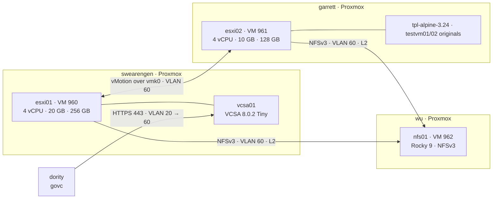

# Nested vSphere 8 Lab — ESXi and vCenter on Proxmox

**Status:** COMPLETE — Steps 1–15 built and verified 2026-10-16 → 2026-10-20: install, vCenter, vDS, templates, VMware → Proxmox migration, NFS shared datastore, shared-storage vMotion and a vSphere HA host-failure test. The nested CPU-model fix and cluster EVC were tested and **don't work nested** (§8.10, §8.11). What's still open is in [§12](#12-still-ahead).
**Built:** 2026-10-16 (first attempt) · 2026-10-17 → 2026-10-18 · 2026-10-20 (shared storage, HA, CPU/EVC tests)
**Hosts:** `esxi01` (VM 960, swearengen), `esxi02` (VM 961, garrett), `vcsa01` (VCSA Tiny on `esxi01`), `nfs01` (VM 962 on wu, lab NFS server), `dority` as the automation workstation
**Stack:** ESXi 8.0.2 (build 22380479), vCenter Server Appliance 8.0.2 (build 22617221), `govc` (govmomi), Alpine Linux 3.24 test guests, Rocky Linux 9.8 NFS server
**Licensing:** evaluation mode only — no license keys applied (60-day full-feature evaluation)
**Purpose:** Refresh hands-on vSphere operations on current versions: install, vCenter deployment, clustering, distributed switching, shared storage, vMotion, HA, templates — scripted where it makes sense. Lab only; nothing here carries real workloads.

A two-host vSphere 8 cluster running nested on two Proxmox hosts with different
CPU generations. vCenter is deployed from a JSON template with the CLI installer,
the inventory is built with `govc`, and test guests are deployed from a
generalized template. VMs move between hosts with vMotion at zero packet loss —
shared-nothing first (~10 s), then on an NFS datastore from a disposable Rocky
Linux server (2.9 s). vSphere HA is enabled and tested by pulling the power on a
host: the surviving host declared it dead in 18 s and restarted its VM, with the
VM's own log showing where the rest of the 2.5 minutes went (NFSv3 lock expiry).
Two guests are also migrated off vSphere onto Proxmox with Proxmox's native ESXi
importer. Along the way: a nested CPU-feature kernel panic traced to XSAVE,
confirmed by the migration, and then shown to be unfixable one layer down —
hiding XSAVE stops ESXi itself from booting.

---

## 1. The plain-language version, first

- **ESXi is the hypervisor; vCenter is the management plane.** Each ESXi host runs
  VMs on its own. vCenter ties hosts into a cluster so VMs can move between them,
  restart elsewhere when a host dies, and share one network definition.
- **"Nested" means hypervisors inside a hypervisor.** Proxmox runs the ESXi hosts
  as VMs, and ESXi runs its own VMs inside them. Cheap to build; it also exposes
  edge cases that real hardware hides — this lab hit one (see [§9.3](#93-guest-kernel-panic-in-fpstate_reset-xsave)).
- **vMotion moves a running VM between hosts.** Memory is copied while the VM
  keeps running, then a very short pause hands it over. With no shared storage,
  the disk moves too ("shared-nothing vMotion"); with shared storage, only the
  running state moves.
- **vSphere HA restarts VMs when a host dies.** An agent on every host watches the
  others; when one stops answering on the network *and* stops writing its
  heartbeat file on the shared datastore, a surviving host boots its VMs. It is a
  restart, not a live move.
- **A distributed switch (vDS) is one switch definition for every host.** vCenter
  owns the configuration and pushes it down; hosts keep forwarding even if vCenter
  is down.
- **A template is a "golden image" VM that can't be powered on**, only deployed
  from — after removing anything that must be unique per machine.

---

## 2. Topology



Every ESXi vNIC is a **trunk** (`trunks=20;60;62`, no access tag). ESXi does the
VLAN tagging itself, the way a physical host on a switch trunk would. `nfs01` is
an access port on VLAN 60 only, bridged on wu without passing through the OPNsense
VM.

| Item | Value |
|---|---|
| Lab VLAN | 60 `LAB`, `10.79.60.0/24`, gateway `10.79.60.1` on OPNsense |
| `vcsa01` | `10.79.60.10` — `vcsa01.greenbean.org` |
| `esxi01` | `10.79.60.11` — VM 960 on swearengen |
| `esxi02` | `10.79.60.12` — VM 961 on garrett |
| `nfs01` | `10.79.60.15` — VM 962 on wu, `nfs01.greenbean.org` |
| `testvm01` / `testvm02` | `10.79.60.20` / `10.79.60.21` (static) — now Proxmox VMs 970 / 971 on garrett (stopped); ESXi originals powered off as rollback |
| `testvm04` | `10.79.60.22` — clone on `nfs-lab01`, used for vMotion / HA / CPU tests |
| DNS / NTP | Pi-holes `10.79.10.250`, `10.79.10.249` (A + PTR for vcsa01, esxi01, esxi02, nfs01) · NTP `10.79.60.1` |
| Inventory | `greenbean-dc` → `lab-cluster` (HA on) → `esxi01`, `esxi02`; folders `infra`, `templates` |
| Datastores | `esxi01-local` (~240 GB), `esxi02-local` (~112 GB) — VMFS-6, local · `nfs-lab01` (32 GB) — NFSv3, shared |
| Networking | `vSwitch0` (vmnic0): `Management Network` VLAN 60, `Lab-VLAN60` · `lab-vds` (vmnic1): `dpg-lab-60` VLAN 60 |
| SSO domain | `vsphere.local` (`administrator@vsphere.local`) |

---

## 3. Design decisions

1. **Nested ESXi on swearengen and garrett, never on `wu`.** `wu` is the house
   router (OPNsense) and DNS host; nested ESXi load stays off it. **Amended
   2026-10-20:** the small lab NFS server (`nfs01`, 2 GB) runs on wu, because
   neither ESXi host's Proxmox node had RAM to spare (§8.6). Guardrails: wu's thin
   pool could hold every disk on it fully written (344 GB allocated of 1.67 TB),
   so a runaway lab disk can't fill the pool OPNsense lives on; and `onboot=0`, so
   it never starts with the router.
2. **One CPU model on both hosts.** swearengen is Comet Lake, garrett is Kaby Lake.
   Both ESXi VMs use the same custom QEMU model (`Skylake-Client-noTSX-IBRS` +
   `vmx`), so every guest sees an identical CPU and vMotion works without EVC —
   the same principle as EVC, applied one layer down. Cluster EVC turned out not
   to be available nested at all (§8.11), so this is the only compatibility
   mechanism the lab has.
3. **Trunked vNICs with the Proxmox firewall off** (`firewall=0`). Proxmox's
   firewall filters by MAC; nested guests use MACs Proxmox has never heard of.
4. **Management on a standard switch (vmnic0), VM traffic on the vDS (vmnic1).**
   A vDS mistake can't cut vCenter off from its hosts.
5. **Single lab VLAN; vMotion and NFS share vmk0.** Two vmks in one subnet make ESXi
   pick egress ambiguously, so vMotion is tagged on the management vmk and NFS
   leaves through it by routing table. Production would use dedicated VLANs, the
   vMotion TCP/IP stack, a bound storage vmk, and jumbo frames.
6. **OSData capped at 8 GB** (`autoPartitionOSDataSize=8192`). ESXi 8 otherwise
   reserves up to 128 GB of the boot disk, leaving too little VMFS for VCSA.
7. **VCSA on local storage.** Keeps the management plane off NFS, so the NFS
   server going away can't take vCenter down with it.
8. **CLI installer, JSON template, prompted passwords.** Repeatable, and the
   template holds no secrets — safe to keep in version control.
9. **`govc` runs on `dority`, not a Proxmox host.** Hypervisor hosts stay clean;
   tooling lives on the dev box. `dority` only needs HTTPS to vCenter — vCenter
   talks to the hosts itself.
10. **Evaluation mode only.** Every feature is unlocked for 60 days; no keys applied.
11. **A disposable lab NFS server, not the production TrueNAS.** The house
    TrueNAS pool isn't touched by lab work. A 2 GB Rocky Linux VM on thin LVM gives
    the vSphere side everything it needs and tears down cleanly.
12. **NFS mounted by IP, with one command for both hosts.** vCenter identifies an
    NFS datastore by the exact server string and path each host mounted; one host
    by IP and one by name would appear as two datastores. The IP also removes a
    DNS dependency: the Pi-holes sit behind OPNsense on VLAN 10.
13. **HA tuned for IP storage, warnings acknowledged instead of faked.** Isolation
    response *Power off and restart*; one heartbeat datastore and no management
    redundancy acknowledged with advanced options rather than a second export on
    the same disk, which would have satisfied the count without adding any
    redundancy (§8.9).

---

## 4. Step 1 — Proxmox preparation

```bash
cat /sys/module/kvm_intel/parameters/nested     # Y on both hosts
cat /etc/pve/virtual-guest/cpu-models.conf      # identical on both (unclustered → copied by hand)
```

```
cpu-model: esxi-nested
    flags +vmx;-xsaves
    reported-model Skylake-Client-noTSX-IBRS
```

`-xsaves` was added 2026-10-20 as an attempted fix for §9.3. It had no effect on
the panic (§8.10) and is left in place because both hosts must match; the
original line was `flags +vmx` (backup in `/root/cpu-models.conf.bak-2026-10-20`).

VM settings (esxi01; esxi02 identical except memory and disk size):

| Setting | Value | Why |
|---|---|---|
| `ostype` / `machine` | `other` / `q35` | |
| `bios` | `ovmf`, efidisk `pre-enrolled-keys=0` | UEFI without Secure Boot keys keeps nested boot simple |
| `cpu` | `custom-esxi-nested`, 4 cores | exposes VT-x; common baseline (§3.2) |
| `memory` / `balloon` | 20480 (esxi02: 10240) / `0` | ESXi has no balloon driver |
| disk | `sata0`, `ssd=1,discard=on` | ESXi 8 detects none of QEMU's SCSI controllers, PVSCSI included (§9.7) |
| NICs | 2× `vmxnet3`, `trunks=20;60;62`, `firewall=0` | §3.3 |

esxi02 was reduced from 12 GB to 10 GB on 2026-10-20: garrett has 15 GiB and also
hosts other lab VMs. Its guests are 512 MB–1 GB each.

Wipe leftovers from earlier attempts before installing (VM stopped):

```bash
DISK=$(pvesm path local-lvm:vm-960-disk-1)
lvchange -ay ${DISK#/dev/}
blkdiscard -fv $DISK                 # -f required: an old GPT was present
wipefs $DISK                         # no output = clean
qm set 960 --delete efidisk0         # also clear stale UEFI boot entries
qm set 960 --efidisk0 local-lvm:1,efitype=4m,pre-enrolled-keys=0
```

On thin LVM, `blkdiscard` returns the blocks to the pool (Data% → 0) in seconds.
The EFI disk is recreated rather than discarded — discarding it would leave OVMF
with no variable store.

**RAM budget.** Nested ESXi VMs can't balloon, so memory ESXi has touched stays
resident on the Proxmox host. Configured size isn't consumption — esxi01's 20 GB
took about 15 GiB from swearengen with VCSA warmed up — but once touched it can't
be reclaimed, so headroom is planned on configured size.

| Host | Total | Available with the lab running |
|---|---|---|
| swearengen | 46 GiB | ~5.5–6 GiB with VCSA warmed up (VCSA Tiny takes 14 GB inside `esxi01`) |
| garrett | 15 GiB | esxi02 (10 GB) leaves ~2 GiB; other lab VMs stopped while vSphere runs |

---

## 5. Step 2 — ESXi installation

At the installer's boot screen, **Shift+O** and append:

```
autoPartitionOSDataSize=8192 allowLegacyCPU=true
```

(`allowLegacyCPU` only if the installer warns about the CPU.) The red
`late-filesystems activation failed` / `non-persistent storage` lines during
installer boot are expected — it runs from RAM with no disk yet.

After install, eject the ISO from Proxmox (`qm set 960 --ide2 none,media=cdrom`)
and configure in the DCUI (F2 → Configure Management Network): vmnic0 only,
**VLAN 60**, static IPv4, both Pi-holes, FQDN hostname, IPv6 off; enable SSH and
the ESXi Shell under Troubleshooting Options.

### Checkpoint 2 ✅ — both hosts verified over SSH

```bash
esxcli system version get                        # 8.0.2, build 22380479
esxcli system hostname get                       # FQDN correct
esxcli network nic list                          # vmnic0/1, nvmxnet3, Link Up
esxcli network vswitch standard portgroup list   # Management Network → VLAN 60
esxcli network ip interface ipv4 get             # vmk0 STATIC
esxcli storage filesystem list                   # datastore1 ~240 GB / ~112 GB; OSDATA 8.3 GB
vim-cmd vimsvc/license --show                    # Evaluation Mode, expires +60 days
vmkping -I vmk0 esxi02.greenbean.org             # host-to-host L2 across the CRS310
esxcli system ntp set --server=10.79.60.1 --enabled=true
```

`vmkping -I <vmk>` pings out of a specific VMkernel interface — the basic tool
for troubleshooting vMotion and storage networks.

**SSH keys for root.** ESXi reads root's keys from `/etc/ssh/keys-root/authorized_keys`,
and its SSH runs in FIPS 140 mode by default (`esxcli system security fips140 ssh get`),
which silently ignores ed25519 keys. A dedicated ECDSA P-256 key works:

```bash
ssh-keygen -t ecdsa -b 256 -f ~/.ssh/id_ecdsa_esxi -C "aba@dority esxi"
for h in esxi01 esxi02; do
  ssh root@$h.greenbean.org 'cat > /etc/ssh/keys-root/authorized_keys' < ~/.ssh/id_ecdsa_esxi.pub
done
```

with a `~/.ssh/config` block on dority (`Host esxi01.greenbean.org esxi02.greenbean.org`,
`User root`, `IdentityFile ~/.ssh/id_ecdsa_esxi`).

---

## 6. Step 3 — vCenter with the CLI installer

VM port group first. `VM Network` is VLAN 0; VCSA deployed there would land on the
trunk's native VLAN and never reach its gateway. On **both** hosts (same name —
vMotion matches port groups by name):

```bash
esxcli network vswitch standard portgroup add -p "Lab-VLAN60" -v vSwitch0
esxcli network vswitch standard portgroup set -p "Lab-VLAN60" --vlan-id 60
```

Mount the ISO with explicit permissions (see [§9.4](#94-installer-iso-mounted-without-execute-bits)), from swearengen:

```bash
mount -o loop,ro,mode=0555,dmode=0555 /var/lib/vz/template/iso/<vcsa-8.0.2>.iso /mnt/vcsa
```

`/root/vcsa/vcsa01.json` (passwords left empty — the installer prompts for them):

```json
{
  "__version": "2.13.0",
  "new_vcsa": {
    "esxi": { "hostname": "esxi01.greenbean.org", "username": "root", "password": "",
              "deployment_network": "Lab-VLAN60", "datastore": "datastore1" },
    "appliance": { "thin_disk_mode": true, "deployment_option": "tiny", "name": "vcsa01" },
    "network": { "ip_family": "ipv4", "mode": "static", "system_name": "vcsa01.greenbean.org",
                 "ip": "10.79.60.10", "prefix": "24", "gateway": "10.79.60.1",
                 "dns_servers": ["10.79.10.250", "10.79.10.249"] },
    "os": { "password": "", "ntp_servers": "10.79.60.1", "ssh_enable": true },
    "sso": { "password": "", "domain_name": "vsphere.local" }
  },
  "ceip": { "settings": { "ceip_enabled": false } }
}
```

```bash
python3 -m json.tool /root/vcsa/vcsa01.json > /dev/null && echo "JSON OK"
cd /mnt/vcsa/vcsa-cli-installer/lin64
./vcsa-deploy install --accept-eula --no-ssl-certificate-verification --verify-template-only /root/vcsa/vcsa01.json
./vcsa-deploy install --accept-eula --no-ssl-certificate-verification --precheck-only       /root/vcsa/vcsa01.json
tmux new -s vcsa
./vcsa-deploy install --accept-eula --no-ssl-certificate-verification --log-dir /root/vcsa/logs /root/vcsa/vcsa01.json
```

- Password policy enforced at the prompt: **8–20 characters**, upper, lower,
  digit, special, no spaces.
- `--precheck-only` logs into the target host and checks datastore space, port
  group and DNS without deploying anything.
- Run inside `tmux` so a dropped SSH session doesn't kill the install.

### Checkpoint 3 ✅ — deployed in 12 minutes

Stage 1 (OVA → `esxi01`) and stage 2 (services) completed 23:39 → 23:51 UTC.
VAMI at `https://vcsa01.greenbean.org:5480`, vSphere Client at `/ui`, licensing
in Evaluation Mode.

VCSA doesn't autostart with `esxi01`. After a host reboot:
`ssh esxi01.greenbean.org 'vim-cmd vmsvc/power.on 1'` (check maintenance mode
first — §9.12).

---

## 7. Step 4 — Inventory with govc

On `dority`:

```bash
curl -L -o - "https://github.com/vmware/govmomi/releases/latest/download/govc_$(uname -s)_$(uname -m).tar.gz" \
  | sudo tar -C /usr/local/bin -xvzf - govc
```

`~/.govc-lab` holds everything except the password:

```bash
export GOVC_URL=vcsa01.greenbean.org
export GOVC_USERNAME=administrator@vsphere.local
export GOVC_INSECURE=1                      # self-signed lab certificate
export GOVC_DATACENTER=greenbean-dc
```

```bash
source ~/.govc-lab
read -rs -p "SSO password: " GOVC_PASSWORD; export GOVC_PASSWORD; echo
govc about

govc datacenter.create greenbean-dc
govc cluster.create lab-cluster
read -rs -p "ESXi root password: " ESXPW; echo
for h in esxi01 esxi02; do
  govc cluster.add -cluster lab-cluster -hostname $h.greenbean.org \
    -username root -password "$ESXPW" -noverify
done
unset ESXPW

govc folder.create /greenbean-dc/vm/infra
govc object.mv "/greenbean-dc/vm/Discovered virtual machine/vcsa01" /greenbean-dc/vm/infra
govc object.destroy "/greenbean-dc/vm/Discovered virtual machine"

govc object.rename "/greenbean-dc/datastore/datastore1"     esxi01-local
govc object.rename "/greenbean-dc/datastore/datastore1 (1)" esxi02-local
```

- `read -rs` keeps passwords out of shell history and off the screen.
- `-noverify` accepts host SSL thumbprints unchecked — lab only.
- vCenter parks pre-existing VMs in `Discovered virtual machine` when it adds a
  host; `vcsa01` landed there because it was already running on `esxi01`.
- The `vCLS` folder holds vSphere Cluster Services agent VMs, created
  automatically to keep DRS working independently of vCenter. Left alone.

### Checkpoint 4 ✅ — both hosts added in six seconds

---

## 8. Steps 5–15

### 8.1 Step 5 — Distributed switch and vMotion ✅

```bash
govc dvs.create -folder /greenbean-dc/network lab-vds
govc dvs.add -dvs lab-vds -pnic vmnic1 esxi01.greenbean.org esxi02.greenbean.org
govc dvs.portgroup.add -dvs lab-vds -type earlyBinding -vlan 60 dpg-lab-60
```

vMotion on vmk0, both hosts (§3.5):

```bash
esxcli network ip interface tag add -i vmk0 -t VMotion
esxcli network ip interface tag get -i vmk0      # Tags: VMotion, Management
```

### 8.2 Step 6 — Test guest ✅

```bash
govc vm.create -host esxi02.greenbean.org -ds esxi02-local \
  -net dpg-lab-60 -net.adapter vmxnet3 \
  -m 1024 -c 1 -g otherLinux64Guest -disk 8GB -on=false testvm01
```

Alpine **standard** ISO (not `virt` — the full kernel carries every storage and NIC
driver), uploaded with `govc datastore.upload`, attached with
`govc device.cdrom.add/insert/connect`. First boot panicked
([§9.3](#93-guest-kernel-panic-in-fpstate_reset-xsave)); booted with `noxsave`, installed in `sys` mode, then
made `noxsave` permanent before the first disk boot:

```bash
mount /dev/sda3 /mnt && mount /dev/sda1 /mnt/boot
sed -i 's/^default_kernel_opts="/&noxsave /' /mnt/etc/update-extlinux.conf   # survives kernel updates
sed -i '/^[[:space:]]*APPEND/ s/$/ noxsave/' /mnt/boot/extlinux.conf         # current entry
umount /mnt/boot /mnt
```

VMware Tools (community repo). `guestinfo` reports the IP to vCenter; `vix` is
what makes guest operations (`govc guest.run`) work — without it vCenter answers
*The guest operations agent is out of date* (§9.15):

```bash
sed -i 's|^#\(.*/community\)$|\1|' /etc/apk/repositories && apk update
apk add open-vm-tools open-vm-tools-guestinfo open-vm-tools-vix
rc-update add open-vm-tools default && rc-service open-vm-tools start
```

### 8.3 Step 7 — Shared-nothing vMotion ✅

```bash
ping -D 10.79.60.20                                                          # shell 1
time govc vm.migrate -host esxi01.greenbean.org -ds esxi01-local testvm01   # shell 2
time govc vm.migrate -host esxi02.greenbean.org -ds esxi02-local testvm01
```

| Direction | Time | Packet loss |
|---|---|---|
| esxi02 → esxi01 (compute + storage) | 10.0 s | 0 |
| esxi01 → esxi02 (compute + storage) | 9.3 s | 0 |

40 pings, 0 lost. Fast because the thin disk held only a few hundred MB and memory
was 1 GB. **Correction (2026-10-20):** this section first described one ping
interval stretching to ~1.024 s as the stun. A baseline run on the same path
(dority → OPNsense → VLAN 60) with no migration at all showed intervals up to
1.033 s, so at 1-second resolution the switchover is indistinguishable from normal
jitter. The stun is measured properly in §8.8.

### 8.4 Step 8 — Template and clones ✅

Generalize, then clone to a template (keeps `testvm01`; `vm.markastemplate`
would convert it in place):

```bash
# in testvm01
rm -f /etc/ssh/ssh_host_* /root/.ash_history && poweroff
# on dority
govc folder.create /greenbean-dc/vm/templates
govc vm.clone -vm testvm01 -template=true -host esxi02.greenbean.org -ds esxi02-local \
  -folder /greenbean-dc/vm/templates -on=false tpl-alpine-3.24
govc vm.clone -vm /greenbean-dc/vm/templates/tpl-alpine-3.24 \
  -host esxi02.greenbean.org -ds esxi02-local -net dpg-lab-60 -on=true testvm02
```

Re-addressed `testvm02` while `testvm01` stayed off (static IPs, no conflict):

```bash
sed -i 's/10\.79\.60\.20/10.79.60.21/' /etc/network/interfaces
sed -i 's/testvm01/testvm02/g' /etc/hostname /etc/hosts
hostname -F /etc/hostname && rc-service networking restart
```

Verified: unique host keys generated on first boot, `noxsave` carried over with
the disk, both guests reachable. Linked clone from a snapshot:

```bash
govc snapshot.create -vm testvm02 base
govc vm.clone -vm testvm02 -snapshot base -link -on=false \
  -host esxi02.greenbean.org -ds esxi02-local testvm03
govc datastore.ls -l -ds esxi02-local testvm03/      # the clone's own files
```

The clone's own disk is **1.0 MB** against ~450 MB written in the parent. govc's
`vm.info` "committed" figure (449 MB) counts the shared parent it reads from, so
check the datastore listing for a linked clone's real footprint.

### 8.5 Step 9 — Migrate VMware → Proxmox ✅

Cold migration of `testvm01` → VM **970** and `testvm02` → VM **971**, onto
**garrett** (swearengen carries TrueNAS and Plex, so migration load stays off it),
using Proxmox's native ESXi import (`pve-esxi-import-tools` 1.0.1, PVE 9.2) — all
from the CLI.

**Pre-migration (vSphere side):**

```bash
govc vm.destroy testvm03                    # linked clone depending on testvm02's snapshot
govc snapshot.remove -vm testvm02 base      # importer doesn't want snapshot chains
govc snapshot.tree -vm testvm02             # empty
```

In each guest — confirm it can boot on VirtIO, record identity. Nothing else is
changed on the source, so it stays a clean rollback copy:

```bash
grep ^features /etc/mkinitfs/mkinitfs.conf  # features="ata base ide scsi usb virtio ext4"
ip addr show eth0 | grep -E 'ether|inet '   # VMware MAC (00:50:56 OUI) + .20 / .21 — recorded off-repo
```

The Linux equivalent of injecting VirtIO drivers into a Windows guest before
migrating: if the initramfs lacks the virtio storage driver, the VM boots on
Proxmox and can't find its root disk.

**Cutover** — clean guest shutdown via VMware Tools, at 05:52:15:

```bash
govc vm.power -s testvm01 testvm02
govc vm.info testvm01 testvm02 | grep -E 'Name:|Power state'   # repeat — shutdown is asynchronous
```

**Import (garrett):**

```bash
read -rs -p "ESXi root password: " ESXPW; echo
pvesm add esxi esxi02 --server esxi02.greenbean.org --username root \
  --password "$ESXPW" --skip-cert-verification 1
unset ESXPW
pvesm list esxi02          # esxi02:ha-datacenter/esxi02-local/testvm01/testvm01.vmx …

time qm import 970 'esxi02:ha-datacenter/esxi02-local/testvm01/testvm01.vmx' --storage local-lvm
```

What the importer produced by default — a faithful copy of the VMware hardware:

```
bios: seabios
boot: order=ide0;scsi0
ide0: none,media=cdrom
memory: 1024
net0: vmxnet3=<source-mac>             ← VMware NIC model and original MAC kept
ostype: l26                            ← guest OS detected from the .vmx
scsi0: local-lvm:vm-970-disk-0,size=8G
scsihw: lsi                            ← LSI emulation, matching the source controller
smbios1: uuid=f1501542-1ee0-5702-…     ← derived from the VMware UUID 421550f1-e01e-0257-…
```

Keeping the MAC and an LSI controller makes the first boot safe even for a guest
without VirtIO drivers. The SMBIOS UUID is the VMware BIOS UUID with the first
three fields byte-swapped (VMware and SMBIOS disagree on endianness), so
UUID-licensed software sees the same machine.

**Convert to native KVM devices:**

```bash
qm set 970 --memory 512
qm set 970 --scsihw virtio-scsi-single
qm set 970 --net0 virtio,bridge=vmbr0,tag=60,firewall=1   # importer doesn't carry VLAN tags
qm set 970 --agent enabled=1
qm set 970 --boot order=scsi0 --delete ide0                # drop the empty VMware CD-ROM
qm start 970
```

The new NIC gets a new MAC; Alpine's `/etc/network/interfaces` isn't MAC-bound,
so `eth0` came up on `10.79.60.20` unchanged. Root is mounted by UUID, so the
controller change didn't matter either.

**Guest fix-up:**

```bash
apk del open-vm-tools open-vm-tools-guestinfo
apk add qemu-guest-agent
rc-update add qemu-guest-agent default && rc-service qemu-guest-agent start
```

```bash
qm guest cmd 970 network-get-interfaces | grep '"ip-address"'   # on garrett: 10.79.60.20
```

**Workaround removed:** on Proxmox the guest runs one hypervisor layer deep, so
`noxsave` was taken out and both guests rebooted cleanly — confirming that the
[§9.3](#93-guest-kernel-panic-in-fpstate_reset-xsave) panic was a nested-virtualization problem, not a guest problem.

```bash
sed -i 's/noxsave //' /etc/update-extlinux.conf && update-extlinux
grep -c noxsave /boot/extlinux.conf          # 0
```

Repeated for `testvm02` → 971, then the stored ESXi credential removed:

```bash
pvesm remove esxi02        # the root password lived in /etc/pve/priv/
```

**Results:**

| | testvm01 → 970 | testvm02 → 971 |
|---|---|---|
| Import time (8 GiB disk) | 2 m 09 s | 2 m 09 s |
| Approx. downtime (shutdown → reachable) | ~8 min | ~15 min (imported second) |
| Data path | garrett (VLAN 10) → OPNsense → esxi02 (VLAN 60), routed | same |

Both guests answer on their original IPs; the ESXi originals stay **powered off**
as the rollback (never run both — same IP, same hostname). VMs 970/971 have
`onboot` unset, so a garrett reboot can't start them next to a running clone on
the same address.

- **The importer copies the full provisioned size** — all 8 GiB, though only ~450 MB
  was written. Sparse disks still cost full transfer time; at scale, size disks
  honestly or budget the window accordingly.
- **Downtime is per VM and serial** here. In a real migration, import in parallel
  or use live import, and schedule the window around the largest disks.
- **The routed path is a lab compromise.** A real migration runs the import on the
  same L2 network as the source hosts, ideally a dedicated one.

### 8.6 Step 10 — Lab NFS server (`nfs01`) ✅

**Sizing.** TrueNAS SCALE wants 8 GB; neither ESXi host's node had it free
(swearengen ~5.5 GiB with VCSA up, garrett 15 GiB total with esxi02 on it). A
Rocky Linux 9 VM at 2 GB does the same job for the vSphere side, so it went on
wu (14 GiB available) under the guardrails in §3.1.

**VM on wu (VMID 962)** from the Rocky 9 GenericCloud image, cloud-init for user,
key and address:

```bash
cd /var/lib/vz/template
wget https://dl.rockylinux.org/pub/rocky/9/images/x86_64/Rocky-9-GenericCloud-Base.latest.x86_64.qcow2
wget https://dl.rockylinux.org/pub/rocky/9/images/x86_64/Rocky-9-GenericCloud-Base.latest.x86_64.qcow2.CHECKSUM
sha256sum -c Rocky-9-GenericCloud-Base.latest.x86_64.qcow2.CHECKSUM

qm create 962 --name nfs01 --ostype l26 --cpu host --cores 2 --memory 2048 --balloon 0 \
  --scsihw virtio-scsi-single --agent enabled=1 --serial0 socket --vga serial0 --onboot 0
qm set 962 --net0 virtio,bridge=vmbr0,tag=60,firewall=1
qm set 962 --scsi0 local-lvm:0,import-from=/var/lib/vz/template/Rocky-9-GenericCloud-Base.latest.x86_64.qcow2,discard=on,ssd=1,iothread=1
qm disk resize 962 scsi0 16G
qm set 962 --scsi1 local-lvm:32,discard=on,ssd=1,iothread=1
qm set 962 --ide2 local-lvm:cloudinit
qm set 962 --boot order=scsi0
qm set 962 --ciuser aba --sshkeys /root/dority-aba.pub
qm set 962 --ipconfig0 ip=10.79.60.15/24,gw=10.79.60.1
qm set 962 --nameserver "10.79.10.250 10.79.10.249" --searchdomain greenbean.org
qm start 962
```

Changing `--sshkeys` after first boot changes the cloud-init instance ID, so the
next boot is treated as a new instance and **regenerates the SSH host keys**.
The new ED25519 fingerprint was read from the serial console (`qm terminal 962`)
and compared with `ssh-keyscan` before adding it to `known_hosts`.

**Export.** Run through SSH with guards, so nothing executes locally if the
connection fails, and the disk is chosen by its Proxmox slot rather than `sdX`
(§9.9):

```bash
ssh aba@10.79.60.15 'sudo bash -s' <<'EOF'
set -euo pipefail
hostnamectl set-hostname nfs01.greenbean.org
dnf -y install nfs-utils firewalld xfsprogs
DATA=/dev/disk/by-id/scsi-0QEMU_QEMU_HARDDISK_drive-scsi1
[ -b "$DATA" ] || { echo "no scsi1 disk — aborting"; exit 1; }
[ "$(blockdev --getsize64 "$DATA")" -eq $((32*1024**3)) ] || { echo "scsi1 is not 32 GiB — aborting"; exit 1; }
! blkid "$DATA" || { echo "scsi1 not empty — aborting"; exit 1; }
mkfs.xfs -L vsphere "$DATA"
mkdir -p /srv/vsphere
grep -q 'LABEL=vsphere' /etc/fstab || echo 'LABEL=vsphere /srv/vsphere xfs defaults,noatime 0 0' >> /etc/fstab
systemctl daemon-reload && mount /srv/vsphere
systemctl enable --now fstrim.timer
echo '/srv/vsphere 10.79.60.0/24(rw,sync,no_root_squash,no_subtree_check)' > /etc/exports.d/vsphere.exports
systemctl enable --now nfs-server
exportfs -rav
systemctl enable --now firewalld
firewall-cmd --permanent --new-zone=nfs-lab
firewall-cmd --permanent --zone=nfs-lab --add-source=10.79.60.0/24
firewall-cmd --permanent --zone=nfs-lab --add-service={nfs,mountd,rpc-bind}
firewall-cmd --reload
EOF
```

| Option / setting | Why |
|---|---|
| `sync` | The server acknowledges only after data is on disk. With `async`, a server crash loses writes ESXi already considers committed — corrupt VM disks. |
| `no_root_squash` | ESXi mounts and writes as root. With root squashed, the mount succeeds and the first VM create fails on permissions. Scoping the export to the lab /24 is what makes this acceptable. |
| firewalld `nfs-lab` zone: `nfs`, `mountd`, `rpc-bind` | An NFSv3 client needs rpcbind (111) to find mountd (20048 on EL9), then NFS on 2049. ESXi doesn't use NLM — it locks with `.lck` files on the datastore — so statd/lockd stay closed. `public` keeps ssh only. |
| `fstrim.timer` + `discard=on` | When ESXi deletes files, XFS frees the blocks, `fstrim` sends TRIM to the virtual disk, and `discard=on` passes it to LVM thin on wu. Without the guest's `fstrim`, `discard=on` does nothing. |
| `LABEL=vsphere` in fstab | The label is inside the filesystem, so it follows the disk whatever device name it gets. |

### Checkpoint 10 ✅

```
/srv/vsphere  /dev/sda  xfs  rw,noatime            ← scsi1, which enumerated as sda
+3 +4 +4.1 +4.2                                    ← /proc/fs/nfsd/versions
100005  3  tcp  20048  mountd  ·  100003  3  tcp  2049  nfs
/srv/vsphere  10.79.60.0/24(sync,…,rw,secure,no_root_squash,no_all_squash)
nfs_export_all_rw --> on                           ← EL default SELinux boolean
```

`mkfs.xfs` printed *Discarding blocks…Done*: TRIM reaches the thin LV end to end.
A + PTR for `nfs01.greenbean.org` on both Pi-holes.

### 8.7 Step 11 — Shared datastore on both hosts ✅

```bash
for h in esxi01 esxi02; do
  ssh $h.greenbean.org 'esxcli system maintenanceMode get; vmkping -I vmk0 -c 2 -d -s 1472 10.79.60.15'
done
govc datastore.create -type nfs -mode readWrite -name nfs-lab01 \
  -remote-host 10.79.60.15 -remote-path /srv/vsphere \
  esxi01.greenbean.org esxi02.greenbean.org
for h in esxi01 esxi02; do ssh $h.greenbean.org 'esxcli storage nfs list'; done
govc datastore.mkdir -ds nfs-lab01 rwtest && ssh aba@10.79.60.15 'ls -la /srv/vsphere' && govc datastore.rm -ds nfs-lab01 rwtest
```

- **`-mode readWrite` is required.** govc mounts NFS read-only by default; the
  first mount came up `Read-Only true` on both hosts (§9.10).
- **`vmkping -d -s 1472`** — a full 1500-byte frame with don't-fragment set — came
  back in 0.5 ms with **TTL 64**: no routed hop between the ESXi hosts and nfs01,
  so storage never touches OPNsense.
- `rwtest` was created `root:root` on nfs01 — `no_root_squash` works.
- `Hardware Acceleration: Not Supported` — no VAAI-NAS plugin, so clones are
  copied through the host and disks on this datastore are thin only.
  `Vmknic: None` — not bound to a vmk; ESXi uses vmk0 by routing table.

### Checkpoint 11 ✅ — `nfs-lab01`, 31.9 GB, read-write on both hosts, one datastore in vCenter (no `(1)`)

### 8.8 Step 12 — vMotion on shared storage ✅

New test guest on the shared datastore. The template's address (.20) belongs to
Proxmox VM 970, which stays stopped; the clone was re-addressed to .22:

```bash
time govc vm.clone -vm /greenbean-dc/vm/templates/tpl-alpine-3.24 \
  -host esxi02.greenbean.org -ds nfs-lab01 -net dpg-lab-60 -on=true testvm04   # 6.7 s
ssh -o BatchMode=yes root@10.79.60.20 'sh -s' <<'EOF'
apk add open-vm-tools-vix && rc-service open-vm-tools restart
sed -i 's/10\.79\.60\.20/10.79.60.22/' /etc/network/interfaces
sed -i 's/testvm01/testvm04/g' /etc/hostname /etc/hosts
hostname -F /etc/hostname
(sleep 1; rc-service networking restart) >/dev/null 2>&1 &
EOF
```

The 6.7 s clone copied ~450 MB through esxi02 over NFS (~70 MB/s, no VAAI). Root
SSH needed a key first: Alpine's sshd is `PermitRootLogin prohibit-password`.

Memory-only migration (no `-ds`, so the disk stays on `nfs-lab01`):

```bash
time govc vm.migrate -host esxi01.greenbean.org testvm04
time govc vm.migrate -host esxi02.greenbean.org testvm04
```

| Migration | What moved | esxi02 → esxi01 | esxi01 → esxi02 | Loss |
|---|---|---|---|---|
| Step 7 | memory + disk (shared-nothing) | 10.0 s | 9.3 s | 0 |
| **Step 12** | **memory only** | **2.9 s** | **2.9 s** | **0** |

The disk copy accounts for the difference. With a 1 GB idle guest, most of the
2.9 s is fixed task overhead (compatibility checks, building the VM on the
destination, taking over the disk lock), not the memory copy.

**Measuring the stun.** A 1-second ping from dority can't see it (§8.3). A 50 ms
ping from inside the lab VLAN can:

```bash
ssh esxi01.greenbean.org 'vmkping -I vmk0 -c 200 -i 0.05 10.79.60.22'   # during esxi02 → esxi01
```

200 sent, 200 received, max RTT 2.9 ms: **the stun was below 50 ms** — too short
to measure this way. The 10-second window covered at least one of the two
switchovers.

### 8.9 Step 13 — vSphere HA and a host-failure test ✅

**Settings** (Configure → vSphere Availability; verified with
`govc object.collect -dump /greenbean-dc/host/lab-cluster configurationEx`):

| Setting | Value | Why |
|---|---|---|
| Host monitoring | Enabled | |
| Host failure response | Restart VMs (priority medium) | default |
| Admission control | Cluster resource percentage, tolerate 1 host failure | On two hosts this reserves ~50% of the cluster. Calculated from reservations, not usage. |
| Host isolation response | **Power off and restart VMs** (`powerOff`) | NFS shares the management network, so an isolated host has almost certainly lost its datastore too; its VMs are hung and their locks expire. Power them off so the restarted copy has no competition. |
| VM Component Protection | PDL: power off and restart (aggressive) · APD: power off and restart (conservative, 180 s delay) | defaults |
| Heartbeat datastores | automatic → `nfs-lab01` | the only shared datastore |
| `das.ignoreInsufficientHbDatastore` | `true` | see below |
| `das.ignoreRedundantNetWarning` | `true` | one uplink, one VLAN for management — a known limitation, not something to fake |

**Two heartbeats.** The HA agents send **network heartbeats** on vmk0. When those
stop, the primary pings the host's management address and checks its **datastore
heartbeat** — a file it keeps updating under `.vSphere-HA/` on a shared datastore.
Network down but datastore heartbeat still updating = isolated or partitioned (VMs
may still be running, don't restart them); both stopped = failed (restart).

```
/srv/vsphere/.vSphere-HA/FDM-<cluster>/
  host-11-hb  host-16-hb            ← datastore heartbeats, one per host
  host-11-poweron  host-16-poweron  ← what each host has powered on
  protectedlist                     ← VMs HA has promised to restart
  .lck-*                            ← ESXi's own NFS lock files
```

**The heartbeat-datastore warning.** HA wants two shared heartbeat datastores so a
single storage path can't hide the difference between failed and isolated. A
second export on nfs01 would have cleared it, but it would sit on the same disk,
server and network — two datastores that fail together. The advanced option
records the real limit instead; in production the two would sit on different
arrays or paths.

Both host warnings cleared after **Reconfigure for vSphere HA** on each host.

**Failover test** — `testvm04` on `esxi02`, `esxi01` as HA primary, then the
esxi02 VM hard-stopped from Proxmox (equivalent to pulling the power):

```bash
date -u +%T.%N; qm stop 961                       # garrett
ping -D -O 10.79.60.22                            # dority
govc events -n 60 /greenbean-dc/host/lab-cluster  # dority, afterwards
ssh esxi01.greenbean.org 'grep -iE "host-16|placement|testvm04" /var/log/fdm.log'
```

| T+ | UTC | Event (vCenter events, esxi01 `fdm.log`, testvm04 `vmware.log`) |
|---|---|---|
| 0 | 16:39:01 | `qm stop 961` |
| 10 s | 16:39:11 | HA: esxi02 **Unreachable** — network heartbeats stopped |
| **18 s** | 16:39:19 | HA: **Host Failed** — ping and datastore heartbeat checks also failed |
| 26 s | 16:39:27 | vCenter: esxi02 **not responding** — HA got there first |
| 30 s | 16:39:31 | Failover initiated; testvm04 registered on esxi01 |
| 60 s | 16:40:01 | Placement engine assigns it to esxi01 |
| 70 s | 16:40:11 | VMX process starts on esxi01 |
| 110 s | 16:40:51 | `PowerOnTiming: Module VMMon took 40017233 us` |
| 151 s | 16:41:32 | Disk open completes after another 40 s; **"vSphere HA restarted virtual machine testvm04"** |
| 171 s | 16:41:52 | VMware Tools OK — guest booted |
| 184 s | 16:42:05 | Failover complete |

**Where the 2.5 minutes went.** Detection was quick (18 s). Most of the time was
inside the VM's power-on: two consecutive 40-second waits while opening the VM's
files on NFS — first during monitor setup, most likely the swap file, then the
disk itself. esxi02 died holding NFSv3 locks on those files, and esxi01 had to
wait for each lock to age out before taking it over. The log doesn't name the
swap file directly; the pattern (two equal waits, both on file opens) does. The
timers are visible with
`esxcli system settings advanced list | grep -iA4 "/NFS/Lock"`.

Also seen during the test, all expected:

- *Insufficient resources to satisfy vSphere HA failover level* — with one host
  down, the cluster can't survive another failure. Cleared when esxi02 returned.
- vCLS agent VM power-on retries — it lives on `esxi02-local`. vCLS serves DRS,
  not HA.
- `testvm01`, `testvm02` and **`tpl-alpine-3.24` disconnected** — they live on
  `esxi02-local`. HA protects only powered-on VMs on shared storage; with esxi02
  down, the template is unavailable.

**esxi02 back:** `qm start 961`; HA marked it Unreachable → Slave within about 20 s
of its agent starting, vCenter reconnected it at 16:47:56 UTC, alarms cleared, and
the cluster returned to `green` with no config issues. testvm04 stays on esxi01 —
HA doesn't move VMs back, and without DRS nothing else does.

### Checkpoint 13 ✅ — host failure detected in 18 s, VM restarted on the surviving host, guest up at ~2 m 50 s

### 8.10 Step 14 — CPU-model fix for the XSAVE panic: tested, doesn't work ❌

The idea from §9.3: hide the feature one layer down so ESXi can't pass it on,
and every nested guest boots without `noxsave`.

QEMU fixes a VM's CPU model when the process starts, so each change needs a
Proxmox-level cold boot of the ESXi VM — a reboot inside ESXi keeps the old
CPU. Order: esxi02 first (vCenter stays up); then esxi01 with vcsa01 and
testvm04 shut down cleanly first, so HA had nothing to restart. testvm04 couldn't
be vMotioned to esxi02 in between: once the hosts present different CPUs, vMotion
from the host that still advertises a feature to one that doesn't is refused —
the problem EVC exists to solve.

```bash
# both Proxmox hosts
cp /etc/pve/virtual-guest/cpu-models.conf /root/cpu-models.conf.bak-$(date +%F)
sed -i 's/^\(\s*flags\s\+\)+vmx$/\1+vmx;-xsaves/' /etc/pve/virtual-guest/cpu-models.conf
qm showcmd 961 --pretty | grep -- '-cpu'     # …,+vmx,-xsaves
# per host: maintenance mode → esxcli system shutdown poweroff → qm start → exit maintenance
```

| Attempt | Result |
|---|---|
| `-xsaves` on both hosts, `noxsave` removed from testvm04 | **Same panic**, same instruction: `RIP: fpstate_reset+0x1a`. No change. |
| `-xsaves;-xsave` on esxi02 only | **ESXi 8 refuses to boot:** *Unsupported CPU: Intel family 0x06, model 0x5e* — the hypervisor requires XSAVE itself. Reverted. |
| Guest `noxsave` | Works — **stays the fix** for nested guests |
| Same guest one layer deep (Proxmox, §8.5) | Boots clean without `noxsave` |

**Reading the panic.** `Code: … <48> 89 47 10` decodes to `mov %rax,0x10(%rdi)`
with `RDI: 0` and `CR2: 0x10` — a write through a NULL pointer during early FPU
setup, not a CPU rejecting an XSAVE instruction. The kernel builds its FPU state
from what CPUID reports about XSAVE, and something in what two hypervisor layers
report sends it down a path that uses a pointer it never allocated; `noxsave`
skips that path. The CPUID details are a hypothesis — what's established is that
hiding XSAVES alone doesn't help and hiding XSAVE entirely isn't possible.

Both hosts are left on `+vmx;-xsaves` — harmless, and identical, which is what
vMotion needs (`diff` of the two files confirmed it).

### 8.11 Step 15 — Cluster-level EVC: not available nested ❌

```bash
for h in esxi01 esxi02; do
  govc object.collect -s /greenbean-dc/host/lab-cluster/$h.greenbean.org summary.maxEVCModeKey
done            # empty for both
```

`maxEVCModeKey` is the highest EVC baseline vCenter computes a host can provide;
blank means none. The Change EVC Mode dialog (validated, then cancelled) refused
**Skylake, Broadwell and Merom** alike: *The host's CPU hardware does not support
the cluster's current Enhanced vMotion Compatibility mode.* Merom is a Core 2-era
baseline every one of these CPUs exceeds, so the refusal isn't about missing
features — vCenter can't put these hosts into any EVC mode. That matches the
per-VM EVC refusal in §9.3: EVC works by having ESXi mask CPUID on the hardware,
and nested ESXi on a QEMU CPU model evidently doesn't get that capability. (The
red banner looked identical across the three selections, so it may not refresh
per mode; the blank `maxEVCModeKey` doesn't depend on the dialog.)

**Skylake would have failed on bare metal anyway.** The Skylake EVC mode is the
server Skylake feature set — AVX-512, Protection Keys, XSAVEC, XSAVES. Client parts
(Comet Lake, Kaby Lake) have never had AVX-512, and the dialog's own note says such
"Skylake" processors are admitted only at Broadwell or below. EVC generation names
follow the server feature set, not the CPU's marketing generation.

CPU compatibility in this lab therefore comes only from §3.2 — one identical QEMU
model on both hosts — and vMotion has worked in both directions throughout.

---

## 9. Incidents and corrections

### 9.1 Port group on VLAN 0 — caught before deploy

**Risk:** the default `VM Network` port group is untagged. VCSA deployed there on a
trunked vNIC would sit on the native VLAN with no route to `10.79.60.1`.
**Fix:** `Lab-VLAN60` (VLAN 60) on both hosts before deployment.

### 9.2 Duplicate `datastore1` — wrong host

**Symptom:** `govc vm.create -host esxi02 -ds datastore1` failed: *Provided backing
file is not accessible from host.*
**Cause:** every new host's local datastore is `datastore1`; vCenter renamed the
second to `datastore1 (1)`. `datastore1` resolved to `esxi01`'s disk, which `esxi02`
can't see.
**Fix:** renamed to `esxi01-local` / `esxi02-local` (sizes told them apart). The
rename propagates to the hosts.
**Lesson:** rename local datastores to `<host>-local` as part of host onboarding.

### 9.3 Guest kernel panic in `fpstate_reset` (XSAVE)

**Symptom:** Alpine (kernel 6.18) panicked 0.1 s into boot:
`RIP: fpstate_reset+0x1a` … `Kernel panic - not syncing: Attempted to kill the idle task!`
**Cause:** FPU/XSAVE state initialization. The guest is two hypervisors deep; what
KVM → ESXi report about XSAVE leads the kernel into a NULL write during early FPU
setup (§8.10).
**Tried — per-VM EVC (Westmere):** refused at power-on, *No host is compatible with
the virtual machine.* Cluster EVC is unavailable for the same reason (§8.11).
**Tried — hiding the feature one layer down:** `-xsaves` changed nothing; `-xsave`
stops ESXi 8 from booting (§8.10).
**Fix:** kernel parameter `noxsave` in each nested guest, kept in
`/etc/update-extlinux.conf` so it survives kernel updates (§8.2). **Resolved
2026-10-20** — this is the fix, not a workaround awaiting one. Not needed on real
hardware or one layer deep.

### 9.4 Installer ISO mounted without execute bits

**Symptom:** `./vcsa-deploy: Permission denied`; every file `-r--r--r--` owned by
`nobody`; `chmod` impossible on a read-only mount.
**Cause:** the kernel mounted the ISO's UDF layer, which carries no Unix
permissions.
**Fix:** `mount -o loop,ro,mode=0555,dmode=0555`. Running the wrapper with `bash`
doesn't help — it execs `vcsa-deploy.bin`, which has the same problem.

### 9.5 Template JSON broken by a merge

**Symptom:** `Template syntax validation failed … value ' "settings' on line 33`.
**Cause:** pasting a `ceip` block over the template's own left the JSON malformed.
**Fix:** rewrote the file whole with a quoted heredoc; linted with
`python3 -m json.tool` before the installer saw it.

### 9.6 Eject blocked by the guest

**Symptom:** `govc device.cdrom.eject` hung, then *Connection control operation failed
for disk 'ide0:0'*; `govc vm.power -r` failed with *VMware Tools is not running*.
**Cause:** the live system still had the CD mounted, so the guest had locked the
drive; ejecting a locked drive raises a VM question that blocks the task.
`vm.power -r` is a Tools-driven guest reboot.
**Fix:** `poweroff` in the guest, then eject. (Alternatives: answer with
`govc vm.question`, or unmount in the guest first; `-reset` for a hard reset.)

### 9.7 First attempt — installer saw no disk on PVSCSI

The first `esxi01` (VM 5000, 2026-10-16: i440FX, SeaBIOS, `cpu: host`) was
discarded and rebuilt as VM 960 to the §4 spec.
**Symptom:** the ESXi 8.0.2 installer's disk screen listed `Local: (none)`.
**Cause:** the disk sat on `scsi0` behind QEMU's **VMware PVSCSI** controller. ESXi
ships a pvscsi driver, but QEMU's emulation isn't detected by the ESXi 7/8
installer. Proxmox's other SCSI types don't help either — the LSI 53C8xx and
MegaRAID models have no ESXi 8 driver, ESXi has never had VirtIO, and ESXi 7
removed the legacy vmklinux drivers that once covered old controllers.
**Fix:** put the disk on SATA (set on the disk, not in the SCSI Controller
dropdown) — ESXi's built-in `vmw_ahci` drives it:

```bash
qm set <vmid> --delete scsi0                        # disk becomes unused0
qm set <vmid> --sata0 local-lvm:<volume>
```

**Lesson:** most nested-ESXi setup work is choosing virtual hardware ESXi has a
driver for — SATA disk, vmxnet3 NIC, q35, UEFI.

### 9.8 Guest commands ran on the workstation

**Symptom:** a pasted block began with `ssh aba@10.79.60.15`; the login failed and
every following line ran **on dority**, with sudo. `hostnamectl` renamed dority to
`nfs01.greenbean.org` and an `fstab` line for a nonexistent `LABEL=vsphere` was
appended. `mkfs.xfs` wasn't installed and dority has no `sdb`, so nothing was
formatted.
**Fix:** hostname restored from `/etc/hosts`, the fstab line removed,
`findmnt --verify` clean — the next boot would otherwise have waited ~90 s and
dropped to emergency mode.
**Lesson:** never paste guest commands after an `ssh` line. Send them *through*
SSH — `ssh host 'sudo bash -s' <<'EOF' … EOF` — so nothing runs locally if the
connection fails, and start scripts with a guard that checks they're on the right
machine.

### 9.9 Data disk enumerated as `sda`, OS disk as `sdb`

**Symptom:** the build script's guard aborted: `/dev/sdb` had a GPT. On nfs01 the
16 GB OS disk was `sdb` and the 32 GB data disk `sda`.
**Cause:** `sdX` names follow probe order. With `virtio-scsi-single` each disk has
its own controller, and they can finish probing in either order.
**Fix:** target `/dev/disk/by-id/scsi-0QEMU_QEMU_HARDDISK_drive-scsi1`, which Proxmox
ties to the slot, and check size and emptiness before formatting. The guard
(`! blkid`) is what kept `mkfs.xfs` off the root disk.

### 9.10 NFS datastore mounted read-only

**Symptom:** `esxcli storage nfs list` showed `Read-Only true` on both hosts, though
the export was `rw`.
**Cause:** `govc datastore.create` mounts NFS read-only unless told otherwise; the
export can't override a client that asked for read-only.
**Fix:** `govc datastore.remove`, then recreate with `-mode readWrite`.

### 9.11 Host keys changed on rebuilt hosts

**Symptom:** *REMOTE HOST IDENTIFICATION HAS CHANGED* for both ESXi hosts from dority.
**Cause:** dority's `known_hosts` still held keys from the first install (VM 5000,
2026-10-16) under the same names.
**Fix:** the new fingerprint was checked against a second source — swearengen's
`known_hosts`, which had connected after the rebuild — before
`ssh-keygen -R <name>` and `-R <ip>`. The same check, against the serial console,
was used for nfs01 after cloud-init regenerated its keys.

### 9.12 Maintenance mode across reboots

**Symptom:** after the shutdown, `vim-cmd vmsvc/power.on 1` on esxi01 failed with
`InvalidState`. The host had booted in maintenance mode.
**Observed:** esxi01 came back with maintenance mode **enabled** twice — once after
the earlier lab shutdown (how it was entered isn't recorded), once after it was
entered on the host itself (`esxcli system maintenanceMode set --enable true`)
before a power-off. esxi02, put into maintenance mode through vCenter, came back
**disabled** twice; `govc host.maintenance.exit` then
fails with *not allowed in the current state* because there's nothing to exit.
**Lesson:** after any host reboot, check `esxcli system maintenanceMode get` before
relying on it. A host in maintenance mode won't power on VMs, and HA won't place
VMs there.

### 9.13 ESXi ignores ed25519 keys

**Symptom:** key installed in `/etc/ssh/keys-root/authorized_keys`, password still
prompted. `ssh -v` showed the ed25519 key offered and passed over.
**Cause:** ESXi's SSH runs in FIPS 140 mode by default; ed25519 isn't FIPS-approved.
**Fix:** a dedicated ECDSA P-256 key for the ESXi hosts (§5).

### 9.14 HA failover looked like a failure

**Symptom:** no ping replies from testvm04 for ~2 minutes after the host stop; the
first watch was abandoned at T+89 s and a second at T+116 s.
**Cause:** the restart completed at T+151 s — two 40-second NFSv3 lock expiries
during power-on (§8.9).
**Lesson:** on NFS datastores, budget HA restart time for lock expiry, not only
for detection. Read `vmware.log` timestamps to see where the time goes.

### 9.15 Guest operations "agent out of date"

**Symptom:** `govc guest.run` → *The guest operations agent is out of date.*
**Cause:** Alpine splits open-vm-tools; the template had `guestinfo` (IP reporting)
but not `vix` (guest operations).
**Fix:** `apk add open-vm-tools-vix && rc-service open-vm-tools restart`. Guest
operations then work with the guest's own root login, without the guest network
or sshd — the vSphere counterpart of `qm guest exec`.

---

## 10. Gotchas

1. **ESXi 8 won't see a disk on any of QEMU's SCSI controllers** — PVSCSI
   included (§9.7). Use SATA.
2. **ESXi has no balloon driver** — set `balloon: 0` on the Proxmox VM.
3. **Proxmox firewall MAC filtering drops nested guest traffic.** `firewall=0` on the ESXi vNICs.
4. **Custom CPU models aren't shared between unclustered Proxmox hosts.** Copy
   `cpu-models.conf` to each, and `diff` them.
5. **`blkdiscard` refuses a disk with a partition table** without `-f`. Confirm
   the path with `pvesm path` first — it can't be undone.
6. **ESXi 8 reserves up to 128 GB for OSData** unless capped at install time
   (Shift+O). It can't be shrunk afterwards without reinstalling.
7. **VCSA needs forward and reverse DNS** that match, before deployment.
8. **VCSA password limit is 20 characters.** Long generated passwords fail.
9. **`qm set` is all-or-nothing** — one bad parameter silently drops the rest.
   Run risky changes as separate commands.
10. **Every new host's datastore is `datastore1`** — see §9.2.
11. **EVC — per-VM or cluster — doesn't work on nested ESXi** on a QEMU CPU model
    (§8.11). Match CPU models one layer down instead.
12. **Alpine's boot prompt waits about one second.** `govc device.boot -delay 10000`
    gives time to open the console; set it back to 0 afterwards. Extra words after
    the label (`lts noxsave`) are appended to its APPEND line.
13. **Alpine's VMware Tools are split.** `guestinfo` reports the IP; `vix` is needed
    for guest operations. Both live in the community repo.
14. **BusyBox `ip` has no `-br`.** Use `ip addr`.
15. **SSO lockout:** a few failed logins lock the account for minutes. A new shell
    without `GOVC_PASSWORD` set burns attempts quickly — or, without `GOVC_URL`,
    fails before trying (*specify an ESX or vCenter URL*).
16. **Cloning to the same IP poisons `known_hosts`.** A re-addressed clone's key gets
    recorded under the template's IP; clear with `ssh-keygen -R <ip>`.
17. **`govc vm.power -s` returns before the guest is off.** Poll the power state
    before importing — a disk still being written gives a corrupt copy.
18. **Remove snapshots and linked clones before migrating.** The importer wants a
    single, consolidated disk.
19. **Proxmox's ESXi importer keeps VMware hardware** (vmxnet3, original MAC, LSI)
    and drops VLAN tags. Convert to VirtIO and re-tag after import.
20. **`pvesm add esxi` stores the ESXi root password** under `/etc/pve/priv/`.
    Remove the storage when the migration is done.
21. **`govc datastore.create -type nfs` mounts read-only by default.** Pass
    `-mode readWrite`.
22. **Mount NFS with one command, by IP, on every host.** Different server strings
    make vCenter see different datastores.
23. **Never script against `sdX` names** in guests with several disks — use
    `/dev/disk/by-id/`.
24. **Paste guest commands through SSH, not after it** (§9.8).
25. **ESXi SSH is FIPS mode** — ed25519 keys are ignored; use ECDSA P-256 or RSA in
    `/etc/ssh/keys-root/authorized_keys`.
26. **Changing cloud-init keys regenerates host keys** on the next boot.
27. **Maintenance mode may or may not survive a reboot** — check it (§9.12).
28. **CPU model changes need a Proxmox cold boot**, not a reboot inside ESXi.
29. **HA heartbeat datastores count only shared storage**; local VMFS doesn't count.
30. **NFSv3 lock expiry dominates HA restart time** — about 40 s per locked file
    here (§8.9).
31. **ESXi 8 requires XSAVE** — removing it from the CPU model gives *Unsupported
    CPU* at boot.

---

## 11. Proxmox ↔ vSphere — concept map

| Proxmox | vSphere |
|---|---|
| Node | ESXi host |
| Web UI on each node / cluster | vCenter Server (separate appliance) |
| Cluster (corosync quorum) | vSphere cluster (DRS / HA, managed by vCenter) |
| Linux bridge, VLAN-aware | Standard vSwitch (per host) / Distributed Switch (vCenter-wide) |
| Bridge VLAN tag on a vNIC | Port group with a VLAN ID |
| Storage (`local-lvm`, NFS, ZFS, Ceph) | Datastore (VMFS, NFS, vSAN, vVols) |
| Live migration | vMotion / Storage vMotion |
| HA manager (`ha-manager`, fencing via watchdog) | vSphere HA (FDM agents, network + datastore heartbeats, isolation response) |
| Templates + `qm clone` (full / linked) | Templates, Content Library, full / linked clones |
| cloud-init drive | Guest customization spec (or cloud-init) |
| `qm guest exec` (QEMU guest agent) | `govc guest.run` (VMware Tools guest operations) |
| CPU type (`host`, named models) | EVC baseline |
| `qm` / `pvesh` / API | `govc`, PowerCLI, vSphere API |

---

## 12. Still ahead

- **Real isolation and partition tests.** The HA test covered a dead host. Cutting
  esxi02's management network while it stays up (isolation response, datastore
  heartbeats still running) hasn't been tested.
- **A second, independent NFS server** for a meaningful second heartbeat datastore,
  and a test of losing `nfs01` (APD handling via VM Component Protection).
- **NFS lock timers** — read `/NFS/Lock*` and test whether restart time follows them.
- **Template refresh:** add `open-vm-tools-vix` and dority's root key to
  `tpl-alpine-3.24`, and move it to `nfs-lab01` so it survives an `esxi02` outage.
- **Content Library** for the template; a **guest customization spec** or cloud-init
  to replace the manual re-IP.
- **vLCM** image-based host management — likely limited to an imported offline
  bundle, since Broadcom's online depot needs an entitlement-bound download token.
- **Dedicated vMotion and storage networks** if a second lab VLAN is ever added end
  to end.
- **Live import** (`qm import … --live-import 1`) to compare downtime against the
  cold migration in §8.5.
- **Decommission the ESXi originals** of `testvm01`/`testvm02` once the Proxmox
  copies have run for a while.
- **Pi-hole PTR for nfs01** returns the short name `nfs01.`; re-enter as the FQDN
  to match the other records.
- **Teardown** before the evaluation expires — checklist below.

### Teardown checklist

vSphere side (while vCenter is up, if anything is to be kept):

- [ ] Power off `testvm04`; `govc vm.destroy testvm04`
- [ ] Disable HA on `lab-cluster`; `govc datastore.remove -ds nfs-lab01 esxi01.greenbean.org esxi02.greenbean.org`

Proxmox side:

- [ ] swearengen: `qm stop 960 && qm destroy 960 --purge`
- [ ] garrett: `qm stop 961 && qm destroy 961 --purge`; VMs 970/971 (`qm destroy … --purge`)
- [ ] Both: restore `cpu-models.conf` from `/root/cpu-models.conf.bak-2026-10-20`, or
      remove the `esxi-nested` model if nothing else uses it
- [ ] Both: VCSA / ESXi / Alpine ISOs under `/var/lib/vz/template/iso`

Lab NFS server (wu):

- [ ] `qm stop 962 && qm destroy 962 --purge` — removing the thin LVs returns the
      space to wu's pool immediately; confirm with `lvs` (Data% drops)
- [ ] Remove the Rocky GenericCloud image and `.CHECKSUM` from `/var/lib/vz/template/`
- [ ] Remove `/root/dority-aba.pub`

DNS and workstation:

- [ ] Pi-hole A + PTR (both Pi-holes): `vcsa01`, `esxi01`, `esxi02`, `nfs01`
- [ ] dority: `~/.govc-lab`; `~/.ssh/id_ecdsa_esxi*` and the ESXi block in
      `~/.ssh/config`; `known_hosts` entries for `.10–.12`, `.15`, `.22`
      (`ssh-keygen -R`)
- [ ] swearengen: remove garrett's root key from `/root/.ssh/authorized_keys` if it
      isn't wanted beyond the lab (`sed -i '/root@garrett/d' /root/.ssh/authorized_keys`)

---

## Known limitations

- **Nested, not hardware.** Performance numbers mean nothing; CPU features differ
  from bare metal. Nested guests need `noxsave` (§9.3), and EVC is unavailable
  (§8.11).
- **One NFS server, one disk.** `nfs-lab01` is the cluster's only shared storage and
  only heartbeat datastore. HA protects against losing a host, not against losing
  `nfs01` — there is no host that could still reach a datastore.
- **NFSv3 lock expiry** adds ~80 s to an HA restart here (§8.9).
- **Single 1 GbE path and one VLAN** for management, vMotion, NFS and VM traffic;
  HA's management-redundancy warning is suppressed, not solved.
- **vCenter runs on a host it manages,** on local storage. `esxi01` down = management
  plane down (HA itself keeps working without vCenter).
- **The template lives on `esxi02-local`** — unavailable whenever esxi02 is down.
- **The NFS server shares a host with the house router** (wu), under the §3.1
  guardrails.
- **RAM is the ceiling** — swearengen ~5.5 GiB free with VCSA running; garrett runs
  esxi02 at 10 GB with other lab VMs stopped.
- **Evaluation licensing** — hosts disconnect from vCenter when it expires.
- **Self-signed certificates**, and host thumbprints accepted with `-noverify`.

---

## Quick reference

| | |
|---|---|
| vSphere Client | `https://vcsa01.greenbean.org/ui` — `administrator@vsphere.local` |
| VAMI | `https://vcsa01.greenbean.org:5480` — appliance `root` |
| Host Client | `https://esxi01.greenbean.org` / `esxi02` — `root` |
| govc session | `source ~/.govc-lab; read -rs GOVC_PASSWORD; export GOVC_PASSWORD` (on `dority`) |
| Inventory | `govc find / -type h` · `govc ls /greenbean-dc/vm` · `govc datastore.info` |
| VM info | `govc vm.info -r <vm>` |
| Migrate | `govc vm.migrate -host <host> [-ds <datastore>] <vm>` (no `-ds` = memory only) |
| Clone | `govc vm.clone -vm <src> [-template=true] [-snapshot s -link] -host … -ds … <name>` |
| Guest command | `export GOVC_GUEST_LOGIN=root:…; govc guest.run -vm <vm> /bin/sh -c '…'` |
| Console | `govc vm.console -h5 <vm>` · boot delay `govc device.boot -vm <vm> -delay 10000` |
| Blocked task | `govc vm.question -vm <vm>` |
| Host state | `govc object.collect -s /greenbean-dc/host/lab-cluster/<host> runtime.connectionState runtime.inMaintenanceMode runtime.dasHostState.state` |
| Maintenance | `govc host.maintenance.enter/exit <host>` · on the host: `esxcli system maintenanceMode get/set --enable` |
| HA config | `govc object.collect -dump /greenbean-dc/host/lab-cluster configurationEx` · `… configIssue` |
| HA logs | `/var/log/fdm.log` on each host · events: `govc events -n 60 /greenbean-dc/host/lab-cluster` |
| EVC capability | `govc object.collect -s <host> summary.maxEVCModeKey` |
| NFS datastore | `govc datastore.create -type nfs -mode readWrite -name <ds> -remote-host <ip> -remote-path <path> <host>…` · `esxcli storage nfs list` |
| Host networking | `esxcli network ip interface ipv4 get` · `... tag get -i vmk0` · `vmkping -I vmk0 [-d -s 1472] <ip>` |
| Host storage | `esxcli storage filesystem list` |
| License | `vim-cmd vimsvc/license --show` |
| VCSA deploy | `vcsa-cli-installer/lin64/vcsa-deploy install --accept-eula --no-ssl-certificate-verification <json>` |
| VCSA power | `ssh esxi01.greenbean.org 'vim-cmd vmsvc/power.on 1'` (`power.shutdown 1` to stop cleanly) |
| Proxmox side | `qm config 960` (swearengen) · `qm config 961` (garrett) · `qm config 962` (wu) · `qm showcmd <id> --pretty \| grep -- -cpu` · `free -h` |
| NFS server | `ssh aba@10.79.60.15` · `exportfs -v` · `rpcinfo -p` · `firewall-cmd --zone=nfs-lab --list-all` |
| ESXi → Proxmox | `pvesm add esxi <id> --server … --username root --password "$PW" --skip-cert-verification 1` · `pvesm list <id>` · `qm import <vmid> '<id>:ha-datacenter/<ds>/<vm>/<vm>.vmx' --storage local-lvm` |
| Migrated guests | VMs 970 / 971 on garrett · `qm guest cmd 970 network-get-interfaces` |
